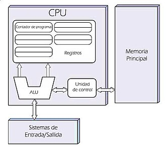
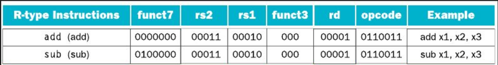

# Arquitectura de Computadoras

Fecha de creación: 7 de agosto de 2026 20:18
Personas: MARIA WANDA MOLINA

# Introducción
## Generaciones del desarrollo de computadoras

### Primera generación (1950)

- Tecnología lógica → tubos de vacío → las computadoras ocupaban aprox 1 millón de $m^3$
- Memoria de tambor magnético y dispositivos de I/O como cintas de papel y magnéticas.
- ENIAC (1945), EDSAC (1949), serie UNIVAC (1950)

### Segunda generación (1960)

- Llegada de los transistores (1957)→ computadoras más pequeñas, baratas y confiables
- Memorias de núcleo magnético, terminales de texto, impresoras y tambores.
- Nacimiento de los lenguajes de programación de alto nivel y el software de sistema.

### Tercera generación (1970)

- Circuitos integrados (1965) de pequeña a media escala (SSI/MSI)
- Chips de memoria RAM/ROM, monitores de video y teclados integrados
- Familia IBM System 360 y PDP-11 → minicomputadoras económicas

### Cuarta generación (1980)

- Integración a gran y muy gran escala (LSI/VLSI) → procesador empaquetado en un solo chip
- Memorias rápidas integradas como SRAM (cache) y DRAM (memoria principal).
- Mouse, sonido, CD y capacidades de red en computadoras de escritorio y portátiles
- Computadoras personales (PC) → Apple e IBM
- Paralelismo a nivel de bits → arquitecturas de 4 bits a 8, 16, 32 y 64 bits

## Arquitectura Von Neumann

La arquitectura de Von Neumann es una familia de arquitecturas de computadoras que utilizan el mismo dispositivo de almacenamiento (memoria principal) tanto para las instrucciones como para los datos. La mayoría de computadoras modernas están basadas en esta arquitectura.



### IPC

Instrucciones por ciclo → métrica que representa el número promedio de instrucciones que un procesador es capaz de ejecutar en un único ciclo de reloj (se busca que sea mayor).

### ISA

Instruction Set Architecture describe la sintaxis y la semántica de la interfaz de una computadora: tipo y tamaño de operandos, estado del registro visible del programador, modelo de memoria, manejo de interrupciones y excepciones, instrucciones disponibles, etc.

### Performance

Se mide en flops, que es la cantidad de operaciones de punto flotante que se realizan por segundo. 

## Ley de Moore

Moore (1965) anticipó que la complejidad de los circuitos integrados se duplicaría cada año, acompañada de una reducción proporcional de sus costos. En 1975 ajustó su estimación, señalando que el número de transistores integrados en un chip de silicio se duplicaría aproximadamente **cada dos años** (frecuentemente citado también como un periodo de entre 18 y 24 meses). Esto permitió anticipar el diseño de los procesadores, disminuyendo sus costos y aumentando su rendimiento.


Los retos de la ley son:

- Frecuencia vs corriente de fuga → el leakage aumenta de forma cúbica con la frecuencia → aumento de manera cúbica de la disipación
- Soft errors →  Este error se debe a que partículas ionizadas impactan contra la juntura de los
transistores; por ejemplo, si una partícula con cierta carga impacta una celda de memoria, esta puede generar un cambio de estado (por ejemplo, puede que haya un 0 donde antes había un 1).
    
Al disminuir el tamaño de la juntura por los avances tecnológicos, la carga eléctrica de la juntura y su tamaño en comparación con la partícula ionizada se vuelven críticamente significativos. Por esta razón, a medida que aumenta la densidad de transistores en un chip, la cantidad relativa de *soft errors* se incrementa de manera exponencial.
    
- El aumento de la densidad de transistores se frenó a partir del 2005 cuando aparecieron los multicores.
- Wire delay → retrasos para alcanzar un porcentaje del procesador en un ciclo, debidos a interconexiones internas en celdas de una FPGA.

## Consumo energético de procesadores

El procesador ingresa energía para transformar información. Sin embargo, no es una máquina en
el sentido tradicional, ya que la energía ingresada no realiza un trabajo útil en términos mecánicos,
sino que se convierte en calor.

- A menor tiempo de operación (mayor frecuencia, lograda mediante la inserción de más transistores más pequeños en una misma área), mayor será la potencia y, por lo tanto, mayor será la temperatura.
- A menor área del transistor, mayor será la densidad de potencia y mayor será la probabilidad
de fundir el transistor. Para no superar el límite de densidad de potencia (100W por centímetro cuadrado) que terminaría fundiendo el transistor se utilizan métodos de refrigeración.

#### Componentes de la potencia

- **Potencia de conmutacion (Dinámica)**

Es la potencia capacitiva que se consume de manera activa cuando los transistores cambian de estado lógico

$P_{conmutacion} = C \cdot V^2 \cdot f$

donde *C* es la capacitancia, *V* el voltaje y *f* la frecuencia de reloj.

- **Potencia de fuga (Estática)**

Es la potencia que el procesador consume constantemente "sin hacer nada", es decir, de manera pasiva incluso cuando no está conmutando. Se debe a que los transistores actuales no se pueden cerrar por completo y sufren fugas de corriente eléctrica

$P_{fuga} = I_{corte} \cdot V_{corte} + I_{saturacion} \cdot V_{saturacion}$

En los procesadores modernos de servidores, esta fuga llega a representar aproximadamente el 40% del consumo total

- **Potencia de cortocircuito**

Se produce momentáneamente cuando dos transistores complementarios que están en oposición conmutan. Durante el brevísimo instante de transición (uno pasa de corte a saturación y el otro viceversa), se genera un camino directo de baja resistencia a tierra (un cortocircuito).

La potencia dinámica de un circuito es:

$*P_{dinamica}=N⋅V^2⋅C⋅f⋅A*$

Donde:

- *N* es la cantidad de transistores.
- *V* es la tensión de alimentación (voltaje).
- *C* es la capacitancia de la carga.
- *f* es la frecuencia de reloj.
- *A* es el factor de actividad.

→ Manteniendo constantes los demás componentes, la potencia es directamente proporcional a la frecuencia. Esto aminora el rendimiento del procesador al procesar menos instrucciones por segundo.

→ Dado que el voltaje se encuentra al cuadrado en la fórmula de la potencia ($*V^2*$), cualquier incremento en la frecuencia que obligue a aumentar el voltaje de forma lineal provoca que **la potencia disipada por el dispositivo aumente de manera cúbica con la frecuencia (**$*P∝f^3*$**)**

Para mejorar el rendimiento teniendo en cuenta la máxima potencia que un dispositivo debe disipar se agregan cores simples y complejos.

### Técnicas para manejar la potencia:

- **Clock Gating:** deshabilita el reloj en una parte del circuito, de manera que los flip-flops en esa parte no consuman energía.
- **Diferentes dominios de reloj para sectores que requieren frecuencias altas**
- **Cores simples →** consumo de menor energía en comparación con los núcleos complejos
- **Transistores con distintos Vth →** optimizar el retardo y/o la potencia.
- **Power Gating →** desconecta de la fuente de alimentación sectores que no están en uso.
- **Ajustes dinámicos de voltaje y frecuencia** → mejorar la compensación potencia/rendimiento

### Cores simples vs complejos

**Cores simples →** ejecutan instrucciones en el orden en que se reciben, sin realizar reordenamiento de instrucciones, ejecución especulativa ni predicción de saltos. Consumo minimalista, menor número de transistores. Eficientes en entornos de alto paralelismo a nivel de datos.

**Cores complejos →** maximizan el paralelismo a nivel de instrucción usando técnicas de microarquitectura como ejecución fuera de orden, ejecución especulativa y predicción de saltos, logrando mayor IPC. Mayor consumo energético y disipación de calor. Indispensables en tareas secuenciales.

A medida que se agregan más núcleos (cores), el throughput aumenta tanto para núcleos simples
como para complejos, aunque también lo hace la potencia. Sin embargo, los núcleos simples tienen un límite en cuanto a throughput, ya que no proporcionan un aumento adicional al incrementar la potencia, a diferencia de los núcleos complejos. En estos últimos, el throughput sigue aumentando con la potencia, aunque con un mayor consumo de energía.

→ Para un número reducido de núcleos, es preferible que sean complejos ya que los simples no ofrecen un aumento significativo del rendimiento al incrementar la potencia.

→ En diseños con buen paralelismo y utilizando muchos núcleos, es preferible que sean simples ya que los complejos consumen mucha más energía.

### ¿Cómo bajar el consumo?

$*P_{dinamica}=N⋅V^2⋅C⋅f⋅A*$

→ Reducir la frecuencia →  reduce la cantidad de instrucciones x segundo → menor rendimiento

→ Reducir la V de alimentación → disminuye la frecuencia de operación y menos tolerante a ruido

→Reducir cantidad de transistores → disminuye el rendimiento del sistema

→ Reducir la capacitancia → menor duración de almacenamiento en la RAM → mayor refresco

→ Reducir la actividad → menos operaciones → menor rendimiento

Siempre es preferible trabajar a la menor tensión posible para una misma frecuencia, ya que de lo contrario se gasta más energía y se disipa más potencia.

A medida que la tecnología avanza y los transistores se vuelven más pequeños, se necesita
atravesar una mayor cantidad de dispositivos para cubrir una misma distancia en el chip. Estos dispositivos adicionales actúan como líneas de transmisión, lo que introduce retardos adicionales en la propagación de señales a través del chip. Como resultado, aunque los chips más avanzados pueden contener más transistores, la fracción del chip que puede ser alcanzada en un solo ciclo de reloj se reduce. Esto implica que, con el avance de la tecnología, es más difícil mantener una comunicación rápida y eficiente entre diferentes partes del chip.

## Rendimiento

Se enfoca en la velocidad a la que se realiza una tarea determinada. 

Dependiendo del punto de vista del evaluador, el rendimiento se define de dos maneras principales:

- **Tiempo de respuesta (o Latencia):** Es el tiempo transcurrido entre el inicio y la finalización de una tarea individual. Es la métrica que más le interesa al usuario individual. Incluye los accesos a disco, accesos a memoria, operaciones de entrada/salida (E/S) y la sobrecarga del sistema operativo.
- **Productividad (o Throughput / Ancho de banda):** Es la cantidad total de trabajo o tareas completadas por unidad de tiempo. Es la métrica crítica para los administradores de centros de datos o servidores.

**Tiempo de ejecución:** intervalo de tiempo transcurrido desde que un usuario ejecuta un programa hasta que recibe la respuesta del sistema.

$Rendimiento = \frac{1}{Tiempo\ de\  ejecucion}$

**Performance:** indica cuantas veces un computador es más rápido que otro de referencia.

$$
Performance = \frac{Rendimiento_A}{ Rendimiento_B} = \frac{Tiempo\ de\ ejecucion_A}{Tiempo\ de\ ejecucion_B}
$$
En general, la performance se mide en términos de throughput y depende de 3 factores principales:
- La frecuencia del reloj -> aumenta hasta cierto punto -> deja de ser fundamental actualmente
- Cantidad total de instrucciones a ejecutar -> depende del programa
- **CPI** (Cycle per Instruction) -> depende de la microarquitectura 
### Tiempo de CPU y CPI

**Tiempo de CPU →** tiempo que tarda el procesador en ejecutar un programa

$Tiempo\ de\ CPU = \frac{Ciclos\ de\ clock\ para\ un\ programa}{Frecuencia\ de\ clock}$

$$
Tiempo\ de\ CPU = \frac{Recuento\ de\ instrucciones * CPI}{Frecuencia\ de\ reloj}
$$

**Tiempo de CPI →** número medio de ciclos de reloj por instrucción

$$
CPI = \frac{Ciclos\ de\ clock\ para\ un\ programa}{Cantidad\ de\ instrucciones}
$$

Cada uno de estos tres factores depende de diferentes componentes del sistema:

1. **Cantidad de instrucciones (Instruction Count - IC):** Es el número de instrucciones que realmente se ejecutan en un programa (conteo dinámico). Depende directamente del **algoritmo**, del **lenguaje de programación** y de la eficiencia del **compilador**, así como de la **arquitectura del conjunto de instrucciones (ISA)**.
2. **CPI (Ciclos por instrucción):** Es el promedio de ciclos de reloj que requiere una instrucción para completarse. Depende de la **ISA** y de la **organización del hardware** (microarquitectura), como la segmentación o la jerarquía de memoria.
3. **Tiempo de ciclo de reloj (o Frecuencia de reloj):** Es la duración de un pulso de reloj (ej. 0.25 ns para un reloj de 4 GHz). Depende de la **tecnología de fabricación de semiconductores** y de la **organización física del hardware**.

### Ley de Amdahl

La **Ley de Amdahl** es una regla que establece que la mejora máxima de rendimiento alcanzable al optimizar una sola parte de una computadora está estrictamente limitada por la fracción de tiempo que el sistema utiliza realmente dicha mejora. El speed up se calcula:

$$
Speed\ up = \frac{1}{(1-F_m)+\frac{F_m}{A_m}}
$$

$F_m$ es la fracción de tiempo que se puede utilizar la mejora y $A_m$ es la aceleración de esa mejora en específico

#### Métricas para medir el rendimiento

- **MIPS (Millones de Instrucciones Por Segundo):** Definido como el número de instrucciones ejecutadas dividido por el tiempo de ejecución multiplicado por $10^6$. El peligro de los MIPS es que **pueden variar de forma inversa al rendimiento real**. Un compilador optimizador puede reducir significativamente el recuento de instrucciones totales eliminando operaciones rápidas; esto acelera el programa, pero como las instrucciones restantes son más complejas, el CPI promedio sube, provocando que la tasa de MIPS disminuya en el programa que corre más rápido. Además, los MIPS impiden comparar máquinas con diferentes ISAs.

$$
MIPS = \frac{Frecuencia\ de\ reloj\ (MHz)}{CPI}
$$

- **MFLOPS (Millones de Operaciones de Punto Flotante Por Segundo):** Es aplicable únicamente para software con cálculos científicos intensivos. No es una métrica consistente porque diferentes máquinas implementan diferentes operaciones complejas de punto flotante en hardware (como raíz cuadrada o senos), haciendo que el número de instrucciones físicas requeridas varíe sustancialmente.

$$
MFLOPS = \frac{Número\ de\ operaciones\ de\ punto\ flotante\ de\ un\ programa}{Tiempo\ de\ ejecución\ × 10^6}
$$

## Benchmark

Un **benchmark** (o programa de prueba) es un programa o conjunto de programas específicamente diseñados para evaluar y comparar el rendimiento (desempeño o prestaciones) de diferentes computadores o arquitecturas.

De la ejecución de un benchmark se esperan principalmente dos cosas:

- **Medir y refinar:** Permite analizar y ajustar los componentes o la configuración de una arquitectura de hardware para maximizar su desempeño.
- **Prever el desempeño:** Ayuda a determinar qué arquitectura disponible es la óptima para ejecutar una aplicación específica con el rendimiento deseado antes de adquirir o construir el hardware

Los programas utilizados para medir el rendimiento se dividen en cuatro categorías:

- **Programas de juguete (*Toys*):** Son programas muy pequeños (de 10 a 100 líneas de código) con un resultado previamente conocido.
- **Benchmarks Sintéticos:** Son programas artificiales diseñados para imitar el perfil de instrucciones y el uso de operandos promedio de una gran base de aplicaciones reales.
- **Núcleos (*Kernels*):** Son fragmentos o bucles clave extraídos de aplicaciones reales que concentran la mayor parte del tiempo de ejecución.
- **Programas Reales:** Son aplicaciones completas de producción con entradas, salidas y opciones reales de usuario.

Para evitar sesgos y asegurar evaluaciones justas entre fabricantes, diversas organizaciones han desarrollado suites estandarizadas de benchmarks:

**SPEC (System Performance Evaluation Cooperative)**

Es una organización financiada por fabricantes de hardware que desarrolla conjuntos de pruebas basados en aplicaciones reales bajo estrictas reglas de ejecución

# Procesadores y Segmentación

Existen dos tipos de microprocesadores:

**RISC (Reduced Instruction Set Computer)**

Instrucciones de tamaño fijo, con un set reducido. Las instrucciones LD y ST son las únicas que pueden acceder a la memoria. 

**CISC (Complex Instruction Set Computer)**

Set de instrucciones amplio y complejo, muchas de ellas con posibilidad de acceder a memoria → dificulta el paralelismo. Procesadores CISC dividen las instrucciones complejas en varias instrucciones de tipo RISC.

## RISC-V

RISC-V es una arquitectura de conjunto de instrucciones (ISA) de código abierto regulada por la asociación sin fines de lucro RISC-V International. A diferencia de opciones propietarias tradicionales como ARM, MIPS o x86, su naturaleza abierta permite que cualquier entidad diseñe, fabrique y venda chips basados en ella sin pagar regalías. 

32 registros de propósito general (x0 a x31) → donde se realizan las operaciones aritmético-lógicas

Registro `x0` cableado a cero constante → read-only → simplifica instrucciones comunes

Memoria direccionable por byte → $2^{30}$ palabras de 32 bits → acceso a palabras completas requiere un desplazamiento de a 4 bytes. 

Filosofía Load-Store → operaciones registro a registro → solo operaciones Data Transfer acceden a memoria

### Repertorio de Instrucciones de RISC-V (Escalar)

A continuación se presentan las instrucciones escalares de RISC-V, categorizadas por su función:

#### A. Instrucciones Aritméticas

Estas instrucciones realizan cálculos matemáticos directos.

| Instrucción | Ejemplo | Significado | Comentarios |
| --- | --- | --- | --- |
| **Suma** (*Add*) | `add x5, x6, x7` | `x5 = x6 + x7` | Suma de tres operandos en registro. |
| **Resta** (*Subtract*) | `sub x5, x6, x7` | `x5 = x6 - x7` | Resta de tres operandos en registro. |
| **Suma inmediata** (*Add immediate*) | `addi x5, x6, 20` | `x5 = x6 + 20` | Se utiliza para sumar constantes (valores inmediatos). |

#### B. Instrucciones de Transferencia de Datos

Permiten mover información de longitud de palabra (32 bits), media palabra (16 bits) o byte (8 bits) entre la memoria RAM y los registros.

| Instrucción | Ejemplo | Significado | Comentarios |
| --- | --- | --- | --- |
| **Cargar palabra** (*Load word*) | `lw x5, 40(x6)` | `x5 = Memory[x6 + 40]` | Carga una palabra (32 bits) de memoria a un registro. |
| **Cargar palabra sin signo** (*Load word, unsigned*) | `lwu x5, 40(x6)` | `x5 = Memory[x6 + 40]` | Carga una palabra de memoria tratándola como valor sin signo. |
| **Almacenar palabra** (*Store word*) | `sw x5, 40(x6)` | `Memory[x6 + 40] = x5` | Almacena una palabra de un registro en memoria. |
| **Cargar media palabra** (*Load halfword*) | `lh x5, 40(x6)` | `x5 = Memory[x6 + 40]` | Carga media palabra (16 bits) con extensión de signo. |
| **Cargar media palabra sin signo** (*Load halfword, unsigned*) | `lhu x5, 40(x6)` | `x5 = Memory[x6 + 40]` | Carga media palabra (16 bits) con extensión de ceros. |
| **Almacenar media palabra** (*Store halfword*) | `sh x5, 40(x6)` | `Memory[x6 + 40] = x5` | Almacena media palabra (16 bits) de un registro en memoria. |
| **Cargar byte** (*Load byte*) | `lb x5, 40(x6)` | `x5 = Memory[x6 + 40]` | Carga un byte (8 bits) con extensión de signo. |
| **Cargar byte sin signo** (*Load byte, unsigned*) | `lbu x5, 40(x6)` | `x5 = Memory[x6 + 40]` | Carga un byte (8 bits) con extensión de ceros. |
| **Almacenar byte** (*Store byte*) | `sb x5, 40(x6)` | `Memory[x6 + 40] = x5` | Almacena un byte (8 bits) de un registro en memoria. |
| **Cargar reservado** (*Load reserved*) | `lr.d x5, (x6)` | `x5 = Memory[x6]` | Carga y reserva; primera mitad de un intercambio atómico. |
| **Almacenar condicional** (*Store conditional*) | `sc.d x7, x5, (x6)` | `Memory[x6] = x5; x7 = 0/1` | Almacena condicionalmente; segunda mitad de intercambio atómico. |
| **Cargar inmediato superior** (*Load upper immediate*) | `lui x5, 0x12345` | `x5 = 0x12345000` | Carga una constante de 20 bits en los 20 bits de mayor peso. |

#### C. Instrucciones Lógicas

Realizan operaciones lógicas bit a bit.

| Instrucción | Ejemplo | Significado | Comentarios |
| --- | --- | --- | --- |
| **AND** | `and x5, x6, x7` | `x5 = x6 & x7` | Operación lógica AND entre tres registros. |
| **OR** (*Inclusive OR*) | `or x5, x6, x7` | `x5 = x6 | x7` | Operación lógica OR entre tres registros. |
| **XOR** (*Exclusive OR*) | `xor x5, x6, x9` | `x5 = x6 ^ x9` | Operación lógica XOR entre tres registros. |
| **AND inmediato** | `andi x5, x6, 20` | `x5 = x6 & 20` | Operación AND bit a bit entre un registro y una constante. |
| **OR inmediato** | `ori x5, x6, 20` | `x5 = x6 | 20` | Operación OR bit a bit entre un registro y una constante. |
| **XOR inmediato** | `xori x5, x6, 20` | `x5 = x6 ^ 20` | Operación XOR bit a bit entre un registro y una constante. |

#### D. Instrucciones de Desplazamiento

Mueven los bits de un registro a la izquierda o derecha.

| Instrucción | Ejemplo | Significado | Comentarios |
| --- | --- | --- | --- |
| **Desplazamiento lógico a la izq.** | `sll x5, x6, x7` | `x5 = x6 << x7` | Desplazamiento a la izquierda por registro. |
| **Desplazamiento lógico a la der.** | `srl x5, x6, x7` | `x5 = x6 >> x7` | Desplazamiento lógico a la derecha por registro. |
| **Desplazamiento aritmético a la der.** | `sra x5, x6, x7` | `x5 = x6 >> x7` | Desplazamiento aritmético (mantiene el bit de signo). |
| **Desplazamiento lógico izq. inmediato** | `slli x5, x6, 3` | `x5 = x6 << 3` | Desplazamiento lógico a la izquierda por constante. |
| **Desplazamiento lógico der. inmediato** | `srli x5, x6, 3` | `x5 = x6 >> 3` | Desplazamiento lógico a la derecha por constante. |
| **Desplazamiento aritmético der. inmediato** | `srai x5, x6, 3` | `x5 = x6 >> 3` | Desplazamiento aritmético a la derecha por constante. |

#### E. Instrucciones de Salto Condicional (Branch)

Bifurcan el flujo de ejecución si se cumple una condición relativa al PC.

| Instrucción | Ejemplo | Significado | Comentarios |
| --- | --- | --- | --- |
| **Saltar si igual** | `beq x5, x6, 100` | `if (x5 == x6) PC = PC + 100` | Salto relativo al PC si los registros son iguales. |
| **Saltar si no igual** | `bne x5, x6, 100` | `if (x5 != x6) PC = PC + 100` | Salto relativo al PC si los registros son distintos. |
| **Saltar si menor que** | `blt x5, x6, 100` | `if (x5 < x6) PC = PC + 100` | Salto relativo al PC si el primer reg. es menor con signo. |
| **Saltar si mayor o igual** | `bge x5, x6, 100` | `if (x5 >= x6) PC = PC + 100` | Salto relativo al PC si el primer reg. es mayor/igual con signo. |
| **Saltar si menor que (sin signo)** | `bltu x5, x6, 100` | `if (x5 < x6) PC = PC + 100` | Salto relativo al PC si el primer reg. es menor sin signo. |
| **Saltar si mayor o igual (sin signo)** | `bgeu x5, x6, 100` | `if (x5 >= x6) PC = PC + 100` | Salto relativo al PC si el primer reg. es mayor/igual sin signo. |

#### F. Instrucciones de Salto Incondicional

Bifurcan el flujo de ejecución sin condiciones.

| Instrucción | Ejemplo | Significado | Comentarios |
| --- | --- | --- | --- |
| **Saltar y enlazar** (*Jump and link*) | `jal x1, 100` | `x1 = PC + 4; PC = PC + 100` | Llamada a procedimiento relativa al PC; guarda retorno en `x1`. |
| **Saltar y enlazar registro** | `jalr x1, 100(x5)` | `x1 = PC + 4; PC = x5 + 100` | Retorno de procedimiento o llamada indirecta usando registro base. |

### Formatos de instrucción

Para que el hardware decodifique las instrucciones de 32 bits de longitud fija a velocidad, RISC-V organiza campos de bits para cada formato

#### R-Type

Se utiliza cuando una operación involucra exclusivamente registros. Se conforma de:



- **`func7` (7 bits):** extensión del código de operación
- **`rs2` (5 bits):** segundo registro fuente
- **`rs1` (5 bits):** primer registro fuente
- **`funct3` (3 bits):** campo de código de operación adicional.
- **`rd` (5 bits):** registro destino donde se guarda el resultado.
- **`opcode` (7 bits):** específica la operación básica y el formato.

#### I-Type

Se utiliza cuando el segundo operando es una constante inmediata o para instrucciones de carga a registros.

- **`immediate` (12 bits):** almacena el valor de la constante inmediata o para instrucciones de carga.
- Los demás mantienen la misma estructura que el tipo R


#### S-Type

Exclusivo para instrucciones que guardan datos en memoria

- **`immediate`** se divide en dos secciones dentro de la instrucción: **`immediate[11:5]`** (7 bits) e **`immediate[4:0]` .** Se hace esto para que los campos de los registros fuente (`rs1` y `rs2`) permanezcan exactamente en las posiciones que en las instrucciones tipo R.


`opcode` → primer campo a decodificar para saber que operación es

### Ejemplo de traducción (C a máquina)

```c
A[30] = h + A[30] + 1
// Asumiendo que el registro x10 contiene
// la direccion base de la tabla A y x21 almacena la variable h
```

```nasm
lw  x9, 120(x10)    # Carga el valor de A[6] en el registro x9.
                    # (30 palabras * 4 bytes = offset 120 bytes)
add x9, x21, x9     # Suma el valor cargado (x9) con la variable h (x21).
addi x9, x9, 1      # Suma la constante inmediata 1 al resultado anterior.
sw  x9, 120(x10)    # Guarda el valor final de x9 de vuelta en la memoria en A[6].
```

Si miramos los valores decimales de los campos de estas instrucciones en el hardware:

| **Instrucción** | **Tipo** | **Inmediato / funct7** | **rs2** | **rs1** | **funct3** | **rd / imm** | **opcode** |
| --- | --- | --- | --- | --- | --- | --- | --- |
| **lw x9, 120(x10)** | **I** | **`120`** | - | **`10`** | **`2`** | **`9`** | **`3`** |
| **add x9, x21, x9** | **R** | **`0`** | **`9`** | **`21`** | **`0`** | **`9`** | **`51`** |
| **addi x9, x9, 1** | **I** | **`1`** | - | **`9`** | **`0`** | **`9`** | **`19`** |
| **sw x9, 120(x10)** | **S** | **`3`** *(bits superiores)* | **`9`** | **`10`** | **`2`** | **`24`** *(bits inferiores)* | **`35`** |

### Stored-program concept

Sentó las bases de la computación moderna

Describe que las instrucciones y datos se pueden almacenar en la memoria en forma de números:

- **Las instrucciones se representan como números:** Los comandos que el hardware entiende son simplemente colecciones de bits (ceros y unos) interpretados numéricamente
- **Los programas se almacenan en la memoria:** El código de máquina se aloja en el mismo sistema de memoria física para ser leído o escrito, exactamente igual que si fuesen datos

### Translating and starting a program


- **Compiler →** Traduce el programa de un lenguaje de alto nivel a lenguaje ensamblador.
- **Assembler →** convierte el archivo de ensamblador en instrucciones binarias de lenguaje máquina → genera el archivo objeto.
- **Linker →** junta los módulos objeto ensamblados y los vincula con rutinas de las bibliotecas → genera un archivo ejecutable
- **Loader →** rutina que lee el archivo ejecutable desde el almacenamiento secundario y lo transfiere a la memoria principal → reserva el espacio de direcciones, copia las instrucciones y datos, inicializa los registros de la CPU (incluyendo el puntero de pila o *stack pointer*) y salta a la rutina de inicio que finalmente llama a la función principal (**`main`**) del programa

## ALU


Representación binaria → signed y unsigned

### Signed

→ bit más significativo para representar el (-) → representación sign-magnitude → no usada → no se puede representar los $2^n$ números sino la mitad, tenemos 2 0 y es un quilombo sumar o restar un número positivo y uno negativo

→ complemento de todo el número +1 → complemento a 2 → ~(N) + 1

Aunque existen múltiples formas de representar números enteros (como signo-magnitud o complemento a 1), la industria de la computación adoptó universalmente el **Complemento a 2** para procesar enteros con signo.

Este estándar tiene propiedades matemáticas únicas que simplifican enormemente el hardware:

- El bit ubicado en el extremo izquierdo (el bit más significativo o MSB) actúa como indicador de signo (0 para positivos, 1 para negativos).
- Para cambiar el signo de un número (de positivo a negativo o viceversa), simplemente se invierten todos sus bits (operación NOT) y se le suma un 1.
- Cuando un operando inmediato de formato corto (por ejemplo, de 16 bits) debe sumarse a un registro de 32 bits, el hardware realiza una "extensión de signo", la cual consiste en replicar el bit de signo en los nuevos bits del extremo izquierdo, preservando intacto el valor del número.

## Datapath

Capítulo 4 →  [https://drive.google.com/file/d/1xpU6sqb-uW4pz7W-NJWF8rtHRt1SdwSP/view?usp=drive_link](https://drive.google.com/file/d/1xpU6sqb-uW4pz7W-NJWF8rtHRt1SdwSP/view?usp=drive_link)

Para todos los tipos de instrucción se realizan los mismos 2 primeros pasos:

- Enviar el PC a la memoria que contiene el código y cargar la instrucción desde esa memoria.
- Leer los registros usando los campos específicos de la instrucción.

Luego:

- Todas las instrucciones menos las de salto incondicional usan la ALU:
    
    → instrucciones de ref de memoria → cálculo de la dirección
    
    → instrucciones aritmético-lógicas → ejecutar operación
    
    → salto condicional → comparación
    
- Con el resultado de la ALU:
    
    → instrucción de ref de memoria → acceder a memoria para r/w
    
    → instrucción aritmético-lógica o carga → guardar el resultado o el leído de la memoria a un registro
    
    → instrucción de salto condicional → modificar la dirección de la sig instrucción (según el resultado de la operación)
    

Las unidades funcionales constan de dos tipos de elementos lógicos:

- **combinacionales →** las salidas dependen únicamente de los valores actuales de las entradas → ALU
- **elementos de estado (secuenciales) →** guardan el estado de la máquina cuando se reinician → memorias de instrucciones y datos, registros
    
    → tienen 2 entradas → valor del dato y el clock (determina cuándo se almacena el dato)
    
    → 1 salida → valor almacenado en un ciclo anterior
    

**Sincronización por flanco:** cualquier valor almacenado en un elemento lógico secuencial se actualiza únicamente en un flanco de reloj.


Todas las señales deben propagarse desde el elemento de estado 1, a través de la lógica combinacional hasta el elemento de estado 2 en un único ciclo de reloj. El tiempo necesario para que las señales alcancen el elemento de estado 2 define la duración del ciclo de reloj.

→ Si el elemento de estado no se actualiza en cada ciclo de reloj → agrega una señal de control write → junto con el clock determinan cuándo se actualiza el elemento.

## Monociclo


- **Unidades de memoria →** almacenan y suministran instrucciones/datos a partir de una dirección.
    
    A diferencia de la memoria de instrucciones, la de datos tiene 2 entradas, una para la dirección a obtener y otra para escribir en caso de instrucción store.
    
- **Program Counter (PC) →** almacena la dirección de la instrucción actual.
- **Sumadores** → 1 encargado de incrementar el PC para que apunte a la dirección de la siguiente instrucción y otro para instrucciones de salto.
- **Banco de registros** → colección de registros donde cualquiera de ellos puede leerse o escribirse especificando su número → contiene el estado de los registros de la máquina.
    
    Lectura de registro → se necesita una entrada en el banco donde se especifique el número de registro que se quiere leer, así como una salida del banco donde se presentará el valor correspondiente.
    
    Escribir un registro → se necesitan dos entradas: una para especificar el número de registro donde escribir y otra para suministrar el dato. El banco de registros siempre devuelve en sus salidas los contenidos de los registros cuyos identificadores están en las entradas de los registros a leer.
    
    
    
    3 inputs indicadores → Dos de ellas especifican los registros de origen que se van a leer (**`RA`** y **`RB`** o *Read registers*), y la tercera específica el registro de destino donde se guardará el resultado (**`RW`** o *Write register*)
    
    2 outputs de datos → Permiten leer y extraer simultáneamente los valores de los dos registros de origen (`busA` y /`busB` o *Read data*) para enviarlos directamente a la ALU sin perder ciclos adicionales.
    
    Las entradas de los identificadores de registro son de cinco
    bits para especificar uno de los 32 ($32 = 2^5$) registros, mientras que los buses de la entrada y las dos salidas de datos son de 32 bits.
    
- **ALU →** Unidad Aritmética Lógica utilizada para el cálculo en instrucciones y direcciones → entradas y salida de 32 bits + 1 bit zero

De este diagrama simplificado falta considerar:

- Ciertos componentes tienen entradas distintas dependiendo de la instrucción en ejecución:
    - PC: su entrada puede ser del primer sumador (instrucción anterior + 4) o del segundo (instrucción de salto → salida del primero + resultado del comparador)
    - Dato escrito en el banco de registro: puede venir de la salida de la ALU o de la memoria de datos.
    
    → Para esto se agregan multiplexores que a partir de señales de control se elige la entrada correcta.
    
- Varias unidades se deben controlar dependiendo del tipo de instrucción:
    - La memoria de datos debe leer en un load y escribir en un store.
    - Se escribe en el banco de registros ante una instrucción load y una aritmético-lógica.
    - La ALU debe realizar una de las tantas operaciones que puede hacer.
    
    → Teniendo como entrada la instrucción (en especial, los campos de las mismas), una nueva unidad de control para todas las demás unidades del datapath
    


En este primer diseño, cada instrucción inicia su ejecución en un flanco de reloj y completa la ejecución en el siguiente flanco de reloj.

→ Se agrega al diseño una unidad de extensión → de 16 bits a un valor signado de 32 bits

### Ejecución de instrucciones de salto condicional

Para instrucciones de salto condicional (branch):

- La dirección de la siguiente instrucción en orden secuencial es la que se utiliza como base de cálculo de la dirección de destino → usa la salida del sumador que hace PC + 4
- En RISC-V, el valor inmediato en las instrucciones de salto condicional (formato Tipo B o *Branch*) e incondicional (formato Tipo J como **`jal`**) se desplaza **solo 1 bit a la izquierda** (lo que equivale a multiplicar por 2). RISC-V fue diseñada para ser una arquitectura modular y moderna que soporta la extensión de instrucciones comprimidas de **16 bits (2 bytes)**. Debido a que las instrucciones pueden medir 2 o 4 bytes, el contador de programa (PC) debe ser capaz de saltar a direcciones alineadas a **media palabra** (múltiplos de 2).

Además de calcular la dirección destino del salto, también se debe determinar
si la siguiente instrucción a ejecutar es la que sigue secuencialmente o la situada en la dirección destino del salto:

→ salto tomado → operandos son iguales, la dirección calculada se carga en el PC

→ salto no tomado → operandos diferentes → PC incrementado +4 


### Unidad de control

Esta tabla muestra los valores de las señales de control para las instrucciones básicas del datapath monociclo de RISC-V (R-format, lw, sw, beq) basadas en el estándar de Patterson & Hennessy (RISC-V Edition):

| **Instrucción** | **ALUSrc** | **MemtoReg** | **RegWrite** | **MemRead** | **MemWrite** | **Branch** | **ALUOp1** | **ALUOp0** |
| --- | --- | --- | --- | --- | --- | --- | --- | --- |
| **Tipo-R** (add, sub, etc.) | 0 | 0 | 1 | 0 | 0 | 0 | 1 | 0 |
| **lw** (load word) | 1 | 1 | 1 | 1 | 0 | 0 | 0 | 0 |
| **sw** (store word) | 1 | X | 0 | 0 | 1 | 0 | 0 | 0 |
| **beq** (branch equal) | 0 | X | 0 | 0 | 0 | 1 | 0 | 1 |

**Descripción del efecto de cada señal en RISC-V:**

| **Señal** | **Efecto cuando es 0 (Desactivada)** | **Efecto cuando es 1 (Activada)** |
| --- | --- | --- |
| **ALUSrc** | El segundo operando de la ALU proviene del segundo registro leído (**`Read data 2`**). | El segundo operando de la ALU es el inmediato generado por el bloque **`ImmGen`**. |
| **MemtoReg** | El valor que se escribe en el banco de registros viene del resultado de la ALU. | El valor que se escribe en el banco de registros viene de la memoria de datos (**`Read data`**). |
| **RegWrite** | No ocurre ninguna escritura en el banco de registros. | El registro destino seleccionado por el campo **`rd`** se escribe con el dato de entrada. |
| **MemRead** | No ocurre ninguna lectura en la memoria de datos. | Se lee el contenido de la memoria de datos en la dirección calculada por la ALU. |
| **MemWrite** | No ocurre ninguna escritura en la memoria de datos. | Se escribe el valor de **`Read data 2`** en la dirección de la memoria de datos. |
| **Branch** | No es un salto condicional. El PC avanza secuencialmente (*PC*+4). | Indica que es una instrucción de salto condicional (se combina con **`Zero`** de la ALU para saltar). |
| **ALUOp[1:0]** | **`00`**: Suma (para loads/stores), **`01`**: Resta (para saltos), **`10`**: Operación tipo R (según **`funct3`**/**`funct7`**). |  |


#### Deficiencia del monociclo

→ La instrucción más lenta (típicamente la de carga) determina el ciclo del clock → las instrucciones más cortas desaprovechan una enorme cantidad de tiempo esperando a que termine el ciclo.

→ Dado que todo debe resolverse en un ciclo, ningún recurso de hardware (ALU, memoria), puede usarse más de una vez por instrucción → separa la memoria en dos (instrucciones y datos), duplicar sumadores para el PC → mayor area.

## Multiciclo

- Divide el combinacional en varias etapas → permite aumentar la frecuencia ya que lo que tarda en viajar el dato  por el combinacional (path delay) se acorta
- Podemos tener una sola ALU y una sola memoria si en cada ciclo se utiliza para algo distinto → en monociclo teníamos  una para las instrucciones, otra para calcular los saltos condicionales y la que calcula la siguiente instrucción de PC.
- Aparecen secuenciales entre combinacionales → guardan el estado entre cada ciclo → registros invisibles
- Se busca que cada etapa sea pareja con las demás → misma cantidad de combinacionales o path delay


Registros intermedios de almacenamiento cuya carga está sincronizada con el clock:

- **IR (Instruction Register):** Retiene la instrucción leída para que las señales de control sigan activas en los ciclos posteriores.
- **MDR (Memory Data Register):** Almacena temporalmente los datos leídos de la memoria.
- **A y B:** Retienen los operandos leídos del banco de registros.
- **ALUOut (o registro Z):** Almacena el resultado calculado por la ALU en el ciclo precedente antes de ser escrito en el banco de registros o en la memoria

### Monociclo vs Multiciclo

- La frecuencia del clock en multiciclo es más alta que en monociclo → el ciclo del clock debe ser lo suficientemente largo para cubrir la etapa más lenta, no la instrucción completa.
- Monociclo tiene un CPI = 1 mientras que el multiciclo tiene un CPI promedio entre 3 y 5 → depende de las instrucciones.
- El rendimiento global de la máquina multiciclo es superior y mucho más eficiente frente a la inclusión de instrucciones complejas (como la división o multiplicaciones en punto flotante) que arruinarían por completo el período del reloj de una máquina monociclo.

El Fan-out of Four (F04) es un concepto utilizado en diseño microelectrónico que se refiere a
la condición en la que una puerta lógica, típicamente un inversor, tiene su salida conectada a cuatro puertas lógicas idénticas a ella (o a una carga capacitiva equivalente).

Retardo F04: Es el retardo de propagación de una compuerta lógica con una carga que es el
cuádruple de la suya propia. Se utiliza como una medida del retardo de una etapa en el pipeline y es independiente de la tecnología.

### Etapas de ejecución

La ejecución de una instrucción se divide secuencialmente en etapas que duran 1 ciclo de reloj c/u

**Búsqueda de instrucción (Instruction Fetch):** En esta etapa, se busca la instrucción en la
memoria. Esto se representa con la instrucción: IR ← Memoria(PC) donde PC es el contador de
programa que apunta a la instrucción actual. Luego, el contador de programa se incrementa en
4 para apuntar a la siguiente instrucción: PC ← PC + 4

**Decodificación y lectura de registros (Decode/Register Fetch):** En esta etapa, se leen
los registros fuente dependiendo del tipo de instrucción. Si la instrucción es de tipo R o I, se
leerán los registros rs y rt: A ← BR(rs), B ← BR(rt).
También se decodifica el tipo de operación para dirigir el flujo de control.

**Ejecución (Execution):**

- Para las instrucciones de tipo R (aritméticas o lógicas), se realiza la operación indicada por
el campo funct: ALUout ← A funct B
- Para las instrucciones de carga (lw) y almacenamiento (sw), se calcula la dirección de
memoria sumando el valor del registro A con la extensión del inmediato: ALUout ← A +
SignExt(immed)
- Para las instrucciones de rama condicional (beq), se resta A de B y se comprueba si el
resultado es cero: A − B

**Acceso a memoria (Memory Access):**

- Para las instrucciones de carga (lw), se accede a la memoria y se almacena el valor en un
registro temporal: MDR ← Memoria(ALUout)
- Para las instrucciones de almacenamiento (sw), el valor de B se escribe en la dirección de
memoria calculada: Memoria(ALUout) ← B

**Escritura de resultados (Write-back):**

- Para las instrucciones de tipo R, el resultado de la ALU se escribe en el registro de destino:
BR(rd) ← ALUout
- Para las instrucciones de carga (lw), el valor cargado desde la memoria se escribe en el
registro de destino: BR(rt) ← MDR


## Pipelining

Es una técnica de implementación de microprocesadores mediante la cual se solapa la ejecución de múltiples instrucciones. Esta técnica se basa en el hecho de que la ejecución de una instrucción se divide en varias fases o etapas secuenciales, de las que se encargan distintas partes dedicadas del hardware.


Esto mejora el throughput → cantidad de instrucciones ejecutadas por ciclo de reloj.

→ Toma ventaja del paralelismo existente entre las acciones necesarias para ejecutar una instrucción.

→ El ciclo está determinado por el tiempo requerido de la etapa más lenta. El tiempo por instrucción de un procesador pipelineado es:

$$
\frac{Tiempo\ por\ instrucción}{Número\ de\ etapas}
$$

A partir de cierta cantidad de etapas, el rendimiento comienza a decrecer debido a:

- A medida que el pipeline se profundiza, cada vez que se produce un problema en el que se debe vaciar el pipeline, como un salto o una excepción, se perderá más cantidad de instrucciones, lo cual afecta negativamente al rendimiento.
- Los pipelines deben transferir la información desde un latch (circuito en el que la entrada pasa a la salida después de un ciclo de reloj) de una etapa a la siguiente, lo que consume una cantidad de tiempo significativa en relación con el retardo producido por la etapa


Para implementarlo:

- todos los ciclos deben durar lo mismo
- todas las instrucciones deben pasar por la mismas etapas → si no terminarían fuera de orden

#### Consideraciones

→ Las instrucciones LOAD constan de las 5 fases de ejecución mientras que las tipo R solo de 4 (no requieren acceder a memoria→ MEM) → para evitar inconsistencias, se añade una etapa adicional MEM en la cual no se realiza ninguna operación pero garantiza que todas las instrucciones pasen por el mismo número de etapas.

→ La lectura de registros ID ocurre en un flanco de reloj, mientras la escritura WB ocurre en otro flanco → se desperdicia medio ciclo ya que ambas operaciones no pueden superponerse


Se divide el banco de registros en dos partes lógicas: la lectura de registros durante la etapa ID y la escritura en registro durante la etapa WB. Para representar este doble uso, en la etapa ID
se dibuja la mitad izquierda del banco de registros sin sombrear y con líneas discontinuas, ya que no está siendo escrito, mientras que en la etapa WB es la mitad derecha del banco de registros la que se dibuja sin sombrear y con líneas discontinuas, ya que no está siendo leído.

Para separar físicamente estas etapas y asegurar que las instrucciones no interfieran entre sí en el mismo ciclo de reloj, se colocan registros de segmentación en las líneas divisorias. Conservan los datos y las señales de control de una instrucción para que la siguiente etapa pueda utilizarlos en el próximo ciclo de clock.


Las señales de control que se obtienen de la instrucción en la etapa ID pueden ser requeridas
en etapas posteriores, por lo que se transmiten a través del pipeline mediante registros. De esta
manera, para una misma señal de control, existen múltiples variantes según la etapa en la que
se encuentren. Ejemplo: Write_Reg_ID, Write_Reg_EX, Write_Reg_MEM, Write_Reg_WB.

Realizar el control significa activar las nueve líneas de control a estos valores en cada etapa para cada instrucción. La manera más simple de hacerlo es extendiendo los registros de segmentación para incluir la información de control. Ya que las líneas de control empiezan en la etapa EX, se puede crear la información de control durante la descodificación de la instrucción. Las señales de control se usan en la etapa de segmentación adecuada mientras la instrucción avanza por el pipeline.

### Pipeline hazards

Situaciones físicas en las que las instrucciones consecutivas en el pipeline no pueden ejecutarse en el siguiente ciclo de reloj

#### Structural Hazards

Ocurre cuando el hardware no puede soportar la combinación de instrucciones que se pretende ejecutar simultáneamente en el mismo ciclo de reloj porque compiten por el mismo recurso físico.

Si el procesador utiliza un único banco de memoria unificado para instrucciones y datos, la etapa de búsqueda de instrucción (IF) de una instrucción posterior entrará en conflicto físico con el acceso a datos (MEM) de una instrucción de carga (load) o almacenamiento (store) previa.


Se genera si el puerto de escritura en el banco de registros (**`WB`**) es requerido al mismo tiempo por una instrucción, mientras otra instrucción en la etapa de decodificación (**`ID`**) intenta leer los registros de origen


**Solución de riesgos estructurales**

Duplicar físicamente los recursos de hardware:

- Para la memoria → Se utiliza una memoria para las instrucciones y otra para los datos, de manera que se puedan leer datos e instrucciones al mismo tiempo.
- Para los registros → Se emplean dos puertos de lectura en el banco de registros para poder leer dos registros simultáneamente o se divide el ciclo de reloj en dos: medio ciclo para la escritura y medio ciclo para la lectura, de forma que se pueda leer y escribir un registro en el mismo ciclo.
- Para la ALU → se agregan sumadores

#### **Data Hazards**

Surgen debido a dependencias de datos entre instrucciones que se ejecutan simultáneamente en el pipeline. Ocurren cuando un operando se intenta leer o escribir antes de que esté listo. Se dividen en tres tipos:

**RAW - Read After Write**

Ocurre cuando una instrucción posterior intenta leer el contenido de un registro antes de que una instrucción anterior haya escrito su resultado en él

```nasm
sub $2, $1,$3    # sub escribe en registro $2
and $12,$2,$5    # 1er operando($2) depende de sub
or $13,$6,$2     # 2º operando($2) depende de sub
add $14,$2,$2    # 1er($2) y 2º($2) depende de sub
sw $15,100($2)   # Base ($2) depende de sub
```

Las últimas cuatro instrucciones dependen todas del resultado de la primera instrucción, guardado en el registro $2.


Los valores que se leen del registro $2 no representarían el resultado de la instrucción sub a menos que la lectura del registro se hiciera durante el ciclo 5 o después.

**Soluciones para RAW**

- Cuando la primera instrucción es tipo R (ejemplo):
    
    Forwarding → Consiste en no esperar a que la instrucción previa escriba físicamente el banco de registros. En cuanto la ALU calcula el resultado en la etapa **`EX`**, este dato es enviado a través de multiplexores y rutas físicas de realimentación directamente a las entradas de la ALU para la instrucción dependiente en el ciclo siguiente.
    
    
    
    
    
    Si ocurre un riesgo de lectura después de escritura (LDE), se debe cortocircuitar la salida de la ALU (de la primera instrucción) con la entrada de la ALU (de la segunda instrucción). 
    
    **EX Hazard (Riesgo en la etapa de Ejecución)**
    
    Ocurre cuando la instrucción **inmediatamente anterior** (la que está un ciclo más adelante, en la etapa de memoria **MEM**) tiene el dato que la instrucción actual (en la etapa **EX**) necesita calcular en la ALU
    

```c
// 1. EX hazard:
if (EX/MEM.RegWrite 
and (EX/MEM.RegisterRd ≠ 0) 
and (EX/MEM.RegisterRd = ID/EX.RegisterRs1)) ForwardA = 10
if (EX/MEM.RegWrite
and (EX/MEM.RegisterRd ≠ 0)
and (EX/MEM.RegisterRd = ID/EX.RegisterRs2)) ForwardB = 10
```

Si la instrucción en MEM escribe un registro (RegWrite = 1), este no es el registro cero, y su destino (RegisterRd) coincide con el primer operando fuente de la ALU (RegisterRs1), entonces ForwardA = 10. **ForwardA = 10** configura el multiplexor para que la ALU **no lea el dato viejo del banco de registros**, sino que tome el resultado recién calculado en el ciclo anterior directo desde el registro de acoplamiento **`EX/MEM`**

**MEM Hazard (Riesgo en la etapa de Memoria)**

Ocurre con una instrucción **dos ciclos más vieja** (la que está en la etapa de escritura **WB**). El dato ya pasó la ALU y la memoria, pero aún no se ha consolidado en el banco de registros en el momento exacto en que la instrucción en la etapa **EX** lo necesita.

```c
// 2.MEM hazard:
if (MEM/WB.RegWrite
and (MEM/WB.RegisterRd ≠ 0)
and (MEM/WB.RegisterRd = ID/EX.RegisterRs1)) ForwardA = 01
if (MEM/WB.RegWrite
and (MEM/WB.RegisterRd ≠ 0)
and (MEM/WB.RegisterRd = ID/EX.RegisterRs2)) ForwardB = 01
```

Si la instrucción en WB escribe un registro, no es el registro cero, y su destino coincide con el operando que la ALU necesita actualmente (RegisterRs1), se activa ForwardA = 01. **ForwardA = 01** configura el multiplexor de la ALU para tomar el dato desde el registro de acoplamiento **`MEM/WB`** (donde ya se encuentra el dato cargado de memoria o el resultado de una instrucción ALU anterior)

- Cuando la primera instrucción es de tipo I
    
    El dato no está disponible físicamente hasta el final de la etapa de acceso a memoria (MEM), que es demasiado tarde para la etapa EX de la instrucción inmediata posterior. Esto no puede resolverse solo con forwarding y requiere que una Unidad de Detección de Riesgos inserte obligatoriamente un ciclo de burbuja (stall) en el pipeline.
    
    
    
    Un **stall** (también conocido como **burbuja**, **detención** o **bloqueo** del pipeline) es un ciclo de reloj de inactividad que se introduce en la segmentación de un procesador para resolver un riesgo (*hazard*). Una unidad de detección de riesgos congela el avance de las primeras etapas del procesador (impidiendo que cambien el contador de programa **`PC`** y el registro de segmentación **`IF/ID`**), obligando al procesador a esperar. A diferencia de una instrucción **`NOP`** (que viaja de principio a fin por todo el cauce sin hacer nada), un *stall* consiste en congelar una etapa específica mientras se permite que las etapas posteriores sigan avanzando para que produzcan el resultado que destrabará la dependencia.
    
    
    
    Si se hace cálculo adelantado de dirección (ALU para salto) y se utiliza una dirección que se está calculando en una etapa anterior, se puede considerar llevar el Forwarding Unit a una etapa antes.
    
- **Solución por Software (Reordenación de Código):** El compilador puede reordenar instrucciones independientes situando otras operaciones útiles entre el **`load`** y la instrucción que utiliza su registro, evitando así que el procesador se detenga.

**WAR - Write After Read** 

Se produce cuando una instrucción posterior intenta escribir en un registro de destino antes de que una instrucción anterior haya leído el valor previo de ese registro.

No ocurre en pipelines estáticos en orden (como DLX o RISC-V básico) porque todas las lecturas de registros se realizan de forma temprana (etapa ID) y las escrituras al final (etapa WB). Aparece únicamente en arquitecturas que permiten la ejecución fuera de orden.

**WAW - Write After Write** 

Sucede cuando una instrucción posterior intenta escribir en un registro antes de que una instrucción previa haya escrito en ese mismo registro

Solo se presenta en pipelines que escriben en más de una etapa o que admiten ejecuciones con latencias variables (como operaciones multiciclo de Punto Flotante o ejecución fuera de orden)

#### **Control Hazards**

Surgen de la necesidad de tomar **decisiones de control de flujo** (bifurcaciones y saltos condicionales `branch`) cuando las instrucciones consecutivas ya han sido buscadas secuencialmente en el pipeline sin conocerse aún si el salto será efectivo o no.

Si un salto es tomado (*taken*), las instrucciones que se buscaron secuencialmente detrás de él en el pipeline son incorrectas y deben ser descartadas (vaciado del cauce o *pipeline flush* convirtiéndolas en instrucciones NOP). Esto inyecta costosos ciclos de stall al procesador.

**Soluciones para riesgos de control**

- **Stall on Branch:** Una opción para manejar los riesgos de control es bloquear o detener el pipeline (stall) hasta que se conozca cuál será la siguiente instrucción que se debe leer en la memoria durante la etapa de IF.


- **Assume Branch Not Taken:** Consiste en continuar buscando instrucciones secuencialmente asumiendo que el salto nunca se tomará. Si el salto no se toma, el rendimiento es óptimo (0 ciclos de penalización); si se toma, se descartan las instrucciones cargadas por error rellenando el pipeline con burbujas y reiniciando la búsqueda en la dirección destino.
- **Delayed Branch:** Otro esquema de manejo de saltos consiste en retardar el salto una instrucción. Esto implica que, después de la instrucción de salto, se genera un ciclo de retardo (delay slot), en el cual generalmente se ejecuta la instrucción siguiente al salto, independientemente de si el salto se realiza o no. De esta manera, se consigue el tiempo necesario para obtener el resultado de la decisión del salto.
    1. Rellenar con alguna instrucción independiente anterior al salto. Esta es la mejor opción.
    2. Rellenar con alguna instrucción ubicada en el destino del salto (suponer salto tomado). Útil en bucles.
    3. Rellenar con alguna instrucción que siga al salto (suponer que el salto no fue tomado). Útil en condiciones IF-ELSE.
- **Predicción de saltos (_Branch Prediction_)**:
    - **Estática**: Aplicar una regla fija fijada en tiempo de compilación (por ejemplo, predecir siempre "no tomado", "tomado", o según la dirección hacia adelante/atrás del salto).
    - **Dinámica**: Usar tablas de historial en tiempo de ejecución (como contadores de 2 bits o el *Branch Target Buffer* / BTB) para predecir si el salto se tomará según su comportamiento reciente.


### Excepciones en RISC V

**Excepción:**  cambio inesperado en el flujo normal de ejecución de las instrucciones, sin importar si la causa es interna o externa. Son síncronas (en sincronía con la ejecución de instrucciones).

**Interrupción:** es un tipo específico de excepción que es de origen externo al procesador. Son asíncronas (ocurren independientemente de la ejecución del programa)

Las excepciones invocan servicios del SO del programa de usuario: Se anulan las escrituras de la instrucción que causó la excepción y se guardan las instrucciones siguientes hasta la etapa MEM. Luego se llama a la rutina de gestión de excepciones. Se requiere que todas las instrucciones anteriores a la excepción se completen correctamente, la instrucción que produjo la excepción debe ser tratada y las instrucciones siguientes deben considerarse como si no hubieran comenzado. 

Las excepciones causadas en cada etapa del pipeline son:


#### Flujo de manejo de excepciones en el pipeline

Para gestionar estos eventos, RISC-V (en su modo Supervisor) utiliza registros específicos de control y estado:

- **SEPC (*Supervisor Exception Program Counter*):** Registro que guarda de forma automática la dirección de la instrucción que causó la excepción.
- **SCAUSE (*Supervisor Exception Cause Register*):** Registra el código o motivo exacto por el cual ocurrió la excepción (por ejemplo, código **`2`** para instrucción no definida o **`12`** para fallo de hardware).
- **STVEC (*Supervisor Trap Vector*):** Guarda la dirección de memoria donde se encuentra el manejador de excepciones del sistema operativo al que el procesador debe saltar.

En una implementación segmentada, las excepciones se tratan físicamente como un **riesgo de control**:

1. **Vaciado del cauce (*Pipeline Flush*):** Se aborta la instrucción causante de la falla y todas las instrucciones posteriores que venían detrás en el pipeline, convirtiéndolas en burbujas o instrucciones sin efecto (**`nop`**) mediante señales de control como **`ID.Flush`** y **`EX.Flush`**.
2. **Bloqueo de escrituras:** El hardware desactiva de inmediato cualquier señal que permita escribir en la memoria o en el banco de registros para la instrucción afectada, asegurando que no se corrompa el estado del procesador.
3. **Transferencia de control:** Se copia el PC de la instrucción afectada en **`SEPC`**, se registra la causa en **`SCAUSE`** y se salta a la dirección del manejador de excepciones almacenada en **`STVEC`**.
4. **Retorno:** Tras resolver el inconveniente, la rutina del sistema operativo ejecuta la instrucción especial **sret** (*Supervisor Exception Return*). Esta instrucción restablece el procesador al modo usuario y salta de vuelta a la dirección almacenada en **`SEPC`** para reiniciar la ejecución.

Es importante vaciar el pipeline antes de manejar la interrupción, ya que las instrucciones posteriores podrían generar excepciones. Si se retoma la ejecución después de la interrupción, estas
excepciones no existirían en el estado recuperado, lo cual podría generar inconsistencias.

#### Excepciones precisas

Son excepciones que, ante cualquier fallo, el hardware garantiza que **todas las instrucciones previas a la que causó la excepción se completaron de forma correcta**, mientras que la **instrucción causante y las posteriores se descartan por completo** y se pueden reiniciar desde el principio como si nunca hubieran comenzado.

En un pipeline, al estar ejecutándose múltiples instrucciones a la vez, las excepciones pueden ocurrir **fuera del orden del programa**. Por ejemplo, una instrucción muy nueva en la etapa de búsqueda (**`IF`**) puede generar un fallo de página antes de que una instrucción más vieja en la etapa de ejecución (**`EX`**) cause un desbordamiento aritmético.

Si el procesador atendiera la excepción de la instrucción nueva de inmediato, rompería la secuencialidad, creando **excepciones imprecisas.**

Para implementar excepciones precisas sin perder rendimiento, el hardware utiliza un **vector de estado de excepciones** asociado individualmente a cada instrucción: a medida que la instrucción avanza por las etapas del pipeline, si genera un fallo, el hardware activa un bit específico en su vector de estado personal. Una vez que se marca un bit de excepción en el vector, se apagan todas las señales de control de esa instrucción que puedan alterar los registros o la memoria física. El vector de estado solo se verifica cuando la instrucción llega al final de su camino, específicamente al inicio de la etapa de escritura **`WB`**. Al evaluarse en esta etapa final, las excepciones se atienden exactamente en el mismo orden cronológico en que ocurrirían en un procesador no segmentado.

#### FP pipeline

Las operaciones punto flotante no se pueden completar en un solo ciclo de reloj dentro de la etapa de ejecución **`EX`** . Por ello, la etapa de ejecución se divide en múltiples subunidades funcionales especializadas que operan en paralelo.


Físicamente, el procesador suele contar con una unidad entera, un sumador de FP, un multiplicador de FP y un divisor de FP. Los módulos como el sumador o el multiplicador de FP están divididos internamente en varias etapas de pipeline (por ejemplo, 3 o 4 etapas). Esto les permite tener un intervalo de iniciación de 1 ciclo de reloj; es decir, pueden recibir una instrucción de FP nueva en cada ciclo sin esperar a que la anterior termine. Sin embargo, otros módulos como el divisor no se suelen segmentar. Tienen latencias altísimas (de 24 a 36 ciclos) y bloquean la unidad por completo (su intervalo de iniciación es igual a su latencia), obligando a cualquier otra división de FP a esperar hasta que la actual finalice.

El hecho de tener instrucciones de FP en vuelo con duraciones tan dispares rompe la sincronización clásica del pipeline, introduciendo problemas complejos:

- Out-of-order-completion: cada unidad tarda un tiempo diferente.
- Aparecen los riesgos WAR y WAW: Por ejemplo, una instrucción rápida podría sobrescribir un registro destino antes de que una instrucción lenta previa haya terminado de calcular su valor
- Varias subunidades de FP pueden finalizar sus cálculos en el mismo ciclo, provocando una contención o colisión física al intentar escribir simultáneamente en el puerto del banco de registros.


# Paralelismo a nivel de instrucción (ILP)

Técnica que consiste en explotar paralelismo entre instrucciones próximas en la secuencia. 

**Bloque básico:** secuencia de código sin saltos → un solo punto de entrada y salida → bloque pequeño → instrucciones con fuerte dependencia.

### Dependencia

Las **dependencias** son características intrínsecas de los programas que determinan el orden obligatorio en el que deben calcularse los resultados, imponiendo un límite al paralelismo que se puede obtener.

Se clasifican en tres tipos fundamentales:

#### **1. Dependencia de datos verdadera (LDE / RAW - Lectura Después de Escritura)**

Ocurre cuando una instrucción *j* depende del resultado de una instrucción anterior *i* porque necesita consumir ese dato.

- **Ejemplo:** `LD F0, 0(R1)` *(escribe en F0)* `ADDD F4, F0, F2` *(intenta leer F0)*

#### **2. Dependencias de nombre (Reutilización de almacenamiento)**

Ocurren cuando dos instrucciones utilizan el mismo registro o posición de memoria, pero **no hay una transmisión real de datos** entre ellas. Se pueden resolver mediante el renombrado de registros.

- **Antidependencia (EDL / WAR - Escritura Después de Lectura):** Una instrucción posterior *j* intenta escribir en un registro antes de que la instrucción anterior *i* lo lea, lo que haría que *i* lea un valor incorrecto.
    - *Ejemplo:* `ADDD F4, F0, F2` seguido de `LD F0, -8(R1)`.
- **Dependencia de salida (EDE / WAW - Escritura Después de Escritura):** Ambas instrucciones escriben en el mismo destino. Si se altera el orden, al final quedará almacenado el dato incorrecto.
    - *Ejemplo:* `ADDD F4, F0, F2` seguido de `SUBD F4, F3, F2`.

#### **3. Dependencias de control**

Determinan el flujo de ejecución del programa. Ocurren cuando la ejecución de una instrucción depende de la resolución de un salto condicional previo.

- *Ejemplo:* Las instrucciones dentro de un bloque `if` dependen de la condición evaluada en la cabecera del condicional.

Los mecanismos de ejecución deben preservar el orden del programa → mismo resultado que en la ejecución secuencial.

### Planificación estática

Se aplican en tiempo de compilación (las realiza el compilador). 

→ Ventaja: no agregan consumo ni complejidad de hardware. 

→ Desventaja: suelen ser menos eficientes porque no pueden adaptarse a lo que ocurre en runtime (por ejemplo, un fallo de caché en un momento específico).

Ejemplo de for implementado en pipeline FP normal:


1. **Planificación de instrucciones (Compiler/Instruction Scheduling):** El compilador reorganiza el orden físico de las instrucciones del código para ocultar latencias de las operaciones (como las esperas de instrucciones de carga o de la ALU de punto flotante) y así evitar paradas (*stalls* o burbujas) en el pipeline, asegurando que el resultado final sea idéntico.

***Planificación por el Compilador → máx(Paralelismo en ejecución)***


2. **Desenrollado de bucles (Loop Unrolling):** Consiste en duplicar el cuerpo de un bucle varias veces en una sola iteración física.
    - **Ventajas:** Expone un bloque más grande de instrucciones independientes y elimina la sobrecarga (*overhead*) de control del bucle, reduciendo saltos y decrementos repetitivos.
    - **Desventajas:** Incrementa el tamaño del código binario (pudiendo provocar fallos en la caché de instrucciones) y genera una gran **presión sobre los registros**.
    
    ***Desenrollado de Bucles → mı́n(Paradas por riesgos de control)***
    
    
    


3. **Software Pipelining (Segmentación por software):** Es un "desenrollamiento simbólico" en el que se reorganiza el bucle de modo que el cuerpo ejecute instrucciones que pertenecen a **diferentes iteraciones** del bucle original al mismo tiempo (por ejemplo, intercalar el almacenamiento de la iteración \(i\), la suma de la iteración \(i-1\) y la carga de la iteración \(i-2\)).
    
    
    
    - **Ventajas:** Elimina las dependencias de datos (*stalls*) en el cuerpo del bucle sin aumentar significativamente el tamaño del código ni la cantidad de registros necesarios.
    - **Desventajas:** Requiere un código adicional (*overhead*) antes de ingresar al bucle para iniciar el flujo (llenar el pipeline o cabecera) y después de este para completarlo (vaciar el pipeline o cola).

---

### Planificación dinámica

Son implementadas en hardware → no en tiempo de compilación.

Consisten en la ejecución fuera de orden → ejecutar instrucciones independientes apenas están listas.

→ ejecución fuera de orden → instrucciones terminan fuera de orden → no tengo excepciones precisas → problema*

Los riesgos estructurales se verifican al decodificar → las instrucciones comienzan cuando sus operandos están disponibles.

- A diferencia de la planificación estática (el compilador lanza instrucciones sin poder resolver en ejecución todas las dependencias), en la dinámica el procesador modifica la secuencia en tiempo de ejecución, resolviendo dependencias sin cambiar el resultado final. Las instrucciones se ejecutan según la disponibilidad de datos y recursos, aprovechando el ILP cuando no hay dependencias.

**Excepciones imprecisas**

Una excepción es imprecisa si al momento de generarse el estado del procesador no es el mismo
que tendría si las instrucciones hubieran sido ejecutadas en orden.

→ El pipeline ya ha completado instrucciones que son posteriores en el orden secuencial del programa a la instrucción que genera la excepción.

→ El pipeline aún no ha completado instrucciones que son anteriores a la que genera la excepción.

### Algoritmo de Tomasulo

Método para manejar las dependencias de datos y mejorar la ejecución fuera de orden en procesadores. Desarrollado por Robert Tomasulo en 1967 para la unidad de punto flotante del procesador IBM 360/91.


Sus componentes fundamentales son:

**1. Cola de Instrucciones**

Las instrucciones se decodifican y se extraen en orden (FIFO) de esta cola para ser emitidas hacia las estaciones de reserva correspondientes.

**2. Estaciones de Reserva (ER / Reservation Stations)**

Son buffers de almacenamiento temporal asociados directamente a las entradas de cada **unidad funcional (FU)** (como sumadores o multiplicadores). Permiten que una instrucción se emita aunque sus operandos no estén listos, esperando allí sin bloquear la cola de instrucciones general.

Cada entrada de una estación de reserva tiene los siguientes campos de control:

- **Busy:** Indica si el *slot* está ocupado.
- **Op:** La operación aritmética o lógica a realizar.
- **Vj, Vk:** Los valores reales de los operandos fuente (si ya están disponibles).
- **Qj, Qk:** Las etiquetas (*tags*) de las estaciones de reserva que están calculando los operandos faltantes. Un valor de **`0`** indica que el operando correspondiente ya está listo en **`Vj`** o **`Vk`**.

**3. Banco de Registros (Register File)**

Cada registro de la arquitectura cuenta con un campo adicional llamado **Qi**.

- Si **Qi es igual a cero** (o vacío), significa que el registro contiene un valor válido y no hay instrucciones pendientes que vayan a escribir en él.
- Si **Qi tiene un valor distinto de cero**, contiene la etiqueta (o ID) de la estación de reserva que producirá el resultado final de ese registro. Cualquier instrucción posterior que necesite leer ese registro tomará la etiqueta **`Qi`** en lugar del valor físico, estableciendo una cadena de dependencias.

**4. Buffers de Carga (Load Buffers) y Almacenamiento (Store Buffers)**

Actúan como estaciones de reserva especializadas para la interfaz con la memoria de datos:

- **Load Buffers:** Retienen las instrucciones de carga pendientes, almacenando la dirección física de memoria y controlando su estado.
- **Store Buffers:** Retienen las instrucciones de almacenamiento de datos. Tienen campos para la dirección de destino y un campo **`Qi`**/**`Vi`** para esperar el valor que se va a guardar en memoria.

**5. Common Data Bus (CDB)**

Es un bus de comunicación común que conecta la salida de todas las unidades funcionales y de memoria directamente con las estaciones de reserva, registros y buffers de almacenamiento. Cuando una unidad termina su cálculo, **difunde el resultado en formato "Etiqueta + Valor"** por el CDB. Todos los componentes que estaban esperando esa etiqueta específica capturan el valor al mismo tiempo en un único ciclo de reloj, resolviendo dinámicamente las dependencias de datos.

### **Las Tres Etapas de una Instrucción**

Toda instrucción en este esquema se procesa a través de tres fases estrictas:

1. **Issue (Emisión):** Se extrae una instrucción de la cola FIFO. Si existe una Estación de Reserva libre correspondiente a la operación, la instrucción se emite. Si los operandos de origen ya están listos en el banco de registros, se copian directamente a la ER. Si no están disponibles, se copia el *tag* de la ER que los generará. Por último, se asocia el registro de destino de la instrucción al ID (etiqueta) de esta ER.
2. **Ejecución:** La instrucción espera pacientemente en su ER monitoreando el CDB. Cuando sus tags de origen \(Q_j\) y \(Q_k\) se vuelven cero (lo que indica que los operandos requeridos se han generado), la unidad funcional ejecuta físicamente la operación.
3. **Escritura de Resultados:** Una vez calculado el valor, la unidad funcional lo emite al CDB junto con la etiqueta de la ER que lo procesó. Todas las ER y registros que esperaban esa etiqueta absorben el dato al mismo tiempo. Finalmente, la estación de reserva se marca como libre.

**Ventajas:** 

- Evita riesgos de datos sin depender de planificación estática por software.
    - Permite realizar **desenrollado de bucles en hardware (*loop unrolling*)** de forma totalmente transparente para el programador y con un número muy reducido de registros arquitectónicos.

**Desventajas:** 

- Introduce una enorme complejidad física debido a las búsquedas asociativas en hardware.
- El CDB se convierte en el principal cuello de botella de rendimiento.
- Provoca **excepciones imprecisas** porque las instrucciones pueden finalizar desordenadamente respecto al programa.

planificación estática → se predicen saltos no tomados para abaratar → 1/6 de los saltos no se toman

### Predicción

**Penalización de saltos**

La **penalización de saltos** (o *branch penalty*) es la pérdida de rendimiento (medida en ciclos de reloj o paradas) que sufre un procesador segmentado cuando se ejecutan instrucciones de salto, debido a que el flujo de instrucciones no es el que el pipeline esperaba (riesgo de control).


Cada salto genera dos dificultades principales:

1. Incertidumbre del flujo: hasta resolver la condición, el procesador no sabe qué instrucción
cargar a continuación en el pipeline.
2. Cálculo de la dirección: en caso de tomarse el salto, se debe calcular la nueva dirección de
destino, lo que introduce demoras.

Es fundamental predecir correctamente los saltos, ya que una predicción precisa promete una ejecución continua del programa. Si la predicción falla, se pierden ciclos de reloj, lo que impacta negativamente en el rendimiento.


### Branch Target Address Cache

La BTAC (Branch Target Address Cache) es una memoria caché especial diseñada para acelerar el flujo de instrucciones en procesadores segmentados. Su propósito principal es almacenar la dirección de destino de los últimos saltos tomados, evitando que el procesador tenga que recalcular físicamente dicha dirección en cada instrucción de salto


#### Predicción fija

→ *Always taken:* mayor número de aciertos de predicción a mayor costo de hardware (Necesita almacenar la dirección de destino del salto).

→ *Always not taken:* menor número de aciertos a menor costo de hardware.

#### Predicción basada en la dirección del salto

→ *Saltos hacia atrás = taken*: la mayoría de los saltos hacia atrás corresponden a bucles.

→ *Saltos hacia adelante = not taken:* la mayoría de los saltos hacia adelante corresponden a IF-THEN-ELSE

- Estas predicciones tienen mal comportamiento en programas con pocos bucles y muchos IF-THEN-ELSE

#### Predicción basada en el OPCODE de la instrucción de salto

El salto es tomado para ciertos opcodes 

#### Predicción dirigida por el compilador

→ según el tipo de construcción de control

→ basada en profiling → predice según el comportamiento de esa instrucción en ejecuciones previas

→ especificado por el programador → indica si el salto debe ser tomado o no


### Predictores dinámicos

Se realizan observando el comportamiento de las instrucciones de salto en las últimas ejecuciones (Historia local). Pueden ser predictores de un bit, 2 o 3.

(predicciones locales → sobre una instrucción → historia de ese salto → loops) ≠ globales (historia de varios saltos → if/else)


Estos predictores se pueden implementar de las siguientes maneras:


Otras formas de gestionar la historia:

- Patrones repetitivos

El comportamiento de los últimos saltos afecta a la predicción actual. Almacenar el comportamiento de los últimos n saltos y usarlos en la selección de la predicción.


- Saltos recientes (historia global)


Cuando llega una instrucción de salto (b1), se debe seleccionar un predictor de los dos para tomar la predicción. Esto se hace en base al último salto: si el mismo no fue tomado, se elige el primer predictor, si lo fue, se elige el segundo. En el caso de que la predicción falle, se debe actualizar el predictor que falló.


El **Tournament Predictor** (o Predictor de Torneo / Predictor Competitivo) es una técnica de **predicción dinámica híbrida.**

- **Predictor Local:** Evalúa la probabilidad de un salto basándose en el historial previo de ejecuciones de esa misma instrucción de salto específica. Es muy preciso para bucles (*loops*) y patrones repetitivos locales.
- **Predictor Global:** Predice el salto basándose en el comportamiento de los últimos M saltos ejecutados en el flujo general del programa (historia global o correlacionada). Es muy eficaz para estructuras condicionales interdependientes como secuencias de `if-then-else`.
- **El Juez (Selector o Meta-predictor):** Es una tabla de contadores saturados de 2 bits indexada por la dirección de la instrucción de salto (o por historia global). Su función es rastrear qué predictor ha dado los mejores resultados recientemente para cada salto en particular.


Los predictores globales son efectivos para las operaciones con enteros, pero no para operaciones de punto flotante, en las que funcionan mejor los predictores locales.


La **recuperación de un fallo de predicción** (*misprediction recovery*) ocurre cuando el procesador ejecuta instrucciones de forma especulativa siguiendo el camino de un salto que predijo, pero al evaluarse la condición real descubre que la predicción fue incorrecta.

Para corregir este error y mantener la integridad del programa, el hardware lleva a cabo **dos tareas principales**:

1. Descarte de los resultados especulativos (*Flush* o Vaciado)

Mientras las instrucciones se ejecutan de manera especulativa, sus resultados **no modifican el estado arquitectónico** (es decir, ni los registros reales del procesador ni la memoria principal).

- **Almacenamiento temporal:** Los resultados provisionales se guardan en estructuras temporales, como los **registros de renombramiento** o el **Buffer de Reordenamiento (ROB)**.
- **Vaciado del cauce (*Pipeline Flush*):** Si la predicción falla, todos los resultados especulativos en los registros temporales se descartan. En pipelines simples, se ponen a cero las señales de control para transformar las instrucciones incorrectas en burbujas o instrucciones nulas (`NOP`).

2. Reanudación de la ejecución por el camino correcto

El procesador debe redirigir el flujo de control hacia las instrucciones verdaderas:

- **Carga de la dirección alternativa:** El procesador carga en el Contador de Programa (`PC`) la dirección de inicio del camino correcto.
    - Si había predicho *Taken* (tomado) y falló, la dirección correcta es la secuencia siguiente (*fall-through*).
    - Si había predicho *Not taken* (no tomado) y falló, la dirección correcta es la dirección destino (*target*) del salto.

Optimización: Reducción del retardo en la recuperación

Para minimizar la penalización en ciclos de reloj provocada por el fallo:

- **Prebúsqueda (*prefetching*):** Algunos procesadores no solo guardan la dirección del camino alternativo, sino que **prebuscan y almacenan las primeras instrucciones** de ese camino en buffers. De este modo, al detectar el fallo, las instrucciones correctas están inmediatamente disponibles sin esperar a leerlas desde la memoria o caché de instrucciones.

#### Ejecución condicional de instrucciones

La **ejecución condicional** (o **ejecución predicada**) es una alternativa de diseño orientada a eliminar o reducir la cantidad de saltos condicionales (*branches*) en el flujo de un programa, convirtiendo dependencias de control en dependencias de datos.

En lugar de bifurcar el Contador de Programa (`PC`) mediante un salto, una instrucción de ejecución condicional combina en su propia estructura:

1. **Una condición** (denominada guarda o predicado).
2. **Una operación**.

- **Si la condición es verdadera:** la instrucción se ejecuta normalmente y confirma su resultado en los registros o memoria.
- **Si la condición es falsa:** la instrucción se anula internamente y se comporta como una operación nula (`NOP`), sin alterar el estado del procesador.

**Ejemplo:** En lugar de utilizar una secuencia con salto como `BNEZ R1, L; MOV R2, R3`, se emplea la instrucción `CMOVZ R2, R3, R1` (copia `R3` en `R2` únicamente si el contenido de `R1` es cero).

- **Ventajas:**
    - **Elimina las penalizaciones por fallo de predicción:** Al eliminar los saltos condicionales, el procesador no sufre vaciados del cauce (*flushes*) ni paradas (*stalls*).
    - Simplifica el flujo de control en estructuras condicionales cortas o simples.
- **Desventajas:**
    - **Consumo de ciclos en vano:** Las instrucciones cuya condición resulta ser falsa deben ser leídas y evaluadas igualmente en el cauce antes de descartarse, consumiendo ciclos de reloj y recursos de procesamiento.
    - **Mayor complejidad en el formato de instrucción:** Se requieren bits adicionales en la codificación de la instrucción para especificar el registro de predicado o la condición a probar.

#### Ejecución con predicados

La **ejecución con predicados** (o **ejecución predicada**) es una técnica para reducir o eliminar las instrucciones de salto condicional en un programa, convirtiendo dependencias de control en dependencias de datos.

- **Estructura de las instrucciones:** Cada instrucción combina una parte de operación y una parte de condición denominada **predicado o guarda**.
- **Registros de predicado:** El resultado de evaluar una condición se almacena en **registros de predicado de 1 bit** (un valor de `1` representa verdadero y `0` representa falso).
- **Comportamiento en el cauce:**
    - **Si la condición del predicado es cierta (1):** la instrucción se ejecuta y confirma su resultado de manera normal.
    - **Si la condición del predicado es falsa (0):** la instrucción se anula internamente y se comporta como una instrucción nula (`NOP`), sin modificar el estado arquitectónico.

Frente a una estructura `if-else` equivalente en código de alto nivel:


En lugar de generar múltiples saltos condicionales (`Blt`, `Bgt`, `jump`), el compilador utiliza instrucciones predicadas:

1. `pred_lt p1(U), p2(U), a, 10` → evalúa si a < 10 y guarda la condición en los registros de predicado p1 y p2.
2. `add c, c, 1 (p2)` → suma c + 1 solo si el predicado p2 es verdadero.
3. `pred_gt p3(U), p4(U), b, 20 (p1)` → evalúa si b > 20 condicionado al predicado p1.
4. `add d, d, 1 (p4)` → suma d + 1 solo si el predicado p4 es verdadero.
5. `add e, e, 1 (p3)` → suma e + 1 solo si el predicado p3 es verdadero.

- **Ventajas:**
    - Elimina los saltos simples y reduce las paradas (*stalls*) o vaciados del cauce (*flushes*) ocasionados por fallos en la predicción de saltos.
- **Desventajas:**
    - **Consumo de tiempo y recursos:** Las instrucciones cuyo predicado resulta ser falso se leen y procesan en el cauce de todos modos antes de anularse.
    - **Complejidad:** La instrucción es más compleja al tener que incluir el predicado además de los operandos y el opcode.

### Especulación

La predicción de saltos introduce especulación: habrá instrucciones cuya ejecución depende de
una predicción. Existen entonces dos tipos de instrucciones en el procesador:

- Independientes: no dependen del salto y se ejecutan siempre de manera normal.
- Dependientes: su ejecución depende del acierto o fallo en la predicción del salto.

ROB → agrega a las etapas de Tomasulo un "commit" → buffer intermedio que reordena las instrucciones para la escritura de los datos a memoria ordenada → resuelve la salida fuera de orden


# Lanzamiento Múltiple y Multithreading
La mejora de la performance llegó a un límite mediante ILP -> se debe recurrir a otras formas de paralelismo.
* ILP -> ejecución en un único hilo -> CPI mínimo de 1
* TLP, Arquitectura superescalares, Ejec. fuera de orden -> ejecución paralela -> permite CPI < 1

## Lanzamiento múltiple de instrucciones
Arquitecturas avanzadas para lanzar más instrucciones por ciclo

Estas arquitecturas requieren:
-> Más hardware
-> Mantener coherencia entre las jerarquías de memoria
### **Procesadores superescalares**

Microarquitecturas escalares que incorporan múltiples vías de emisión (múltiple issue) para sostener la ejecución paralela de instrucciones independientes. Duplican o multiplican parte de sus unidades funcionales para permitir emitir más de una instrucción por ciclo.
Lanza de 1 a 8 instrucciones por ciclo. Existen dos tipos:
-  **Con planificación estática** -> ejecuta instrucciones en orden. Se planifica en tiempo de compilación.
-  **Con planificación dinámica** -> ejecuta instrucciones fuera de orden, aumentando el paralelismo en ejecución puede ser:
	-  *Sin especulación* -> el hardware decide en tiempo de ejecución que instrucciones emitir pero sin especular que camino tomar en los saltos.
	- *Con especulación* -> agrega técnicas de ejecución especulativa para aprovechar más paralelismo. Suele ser más teórico que real ya que eleva la complejidad del hardware.

-> Grado del procesador -> indica la cantidad de instrucciones ejecutándose al mismo tiempo
-> Vías -> indica la cantidad de pipelines en paralelo

Si tenemos un procesador superescalar de grado 2 y 2 vías, entonces, en teoría tendremos un CPI = 0.5 (2 instrucciones por ciclo). En la práctica no se llega a este valor por las instrucciones de salto, LOADs y dependencias LDE. Además, el procesador superescalar genera presión adicional sobre la memoria y un incremento en los riesgos de ejecución, por los cuales se suele reducir el acceso a la memoria a una sola instrucción LOAD por ciclo.

Se alcanza un CPI de 0.5 solo si el programa contiene un 50 % de instrucciones FP y un 50 % de instrucciones enteras.
### Superescalar simple (estático)
Busca, decodifica y emite varias instrucciones por ciclo de reloj manteniendo el estricto orden original del programa.


- Búsqueda y decodificación de instrucciones simultáneamente -> la decodificación se realiza en secuencia y la segunda instrucción solo se lanza si la primera ya fue lanzada
- Para evitar colisiones en la ejecución, suele seguir reglas fijas, como permitir lanzar en paralelo una instrucción entera junto con una de punto flotante. Esto requiere multiplicar o duplicar recursos clave como unidades funcionales segmentadas, buses internos y puertos en el banco de registros (para permitir la lectura simultánea de registros)
- Sin embargo, existen posibles conflictos específicos con instrucciones de carga (load), almacenamiento (store), o movimiento de datos entre registros de punto flotante (FP). 
- El procesador incluye un detector de azares cuya única función es identificar dependencias de datos o conflictos de recursos y detener (_stall_) la emisión cuando se detecta un problema. Para mitigar los conflictos de Dependencia Verdadera (LDE), se debe asegurar una distancia adecuada entre las instrucciones, de manera que los datos necesarios estén disponibles antes de ser requeridos.
- Al tener una planificación fija, no puede adaptarse a eventos impredecibles en tiempo de ejecución (como fallos en la memoria caché) y su rendimiento depende de que el código tenga una mezcla equilibrada de instrucciones independientes.

En este loop desenrollado se realizan 5 LOADs consecutivos para la carga de datos a registros de pf; se ejecutan 5 operaciones ADDD en pf (usando un operando común) y 5 STOREs para escribir el resultado en memoria. Los LOADs son de tipo enteras, permitiendo que se mezclen en el mismo ciclo de operaciones ADDD sin generar conflictos. 
-> El loop queda estructurado de forma fija; el CPI efectivo resulta de aprox 2.4  y no se modifica el código original del programa.

**Ventajas y limitaciones**

- **Ventajas**: Preserva la **compatibilidad binaria**, garantizando que cualquier código ejecute correctamente sin importar la estructura interna del cauce o el ancho de emisión. Además, requiere un hardware sensiblemente menos complejo que los procesadores dinámicos fuera de orden.
- **Desventajas**: Su rendimiento real depende fuertemente de que el programa tenga una mezcla equilibrada de instrucciones independientes. Al poseer una planificación fija, es incapaz de adaptarse a eventos impredecibles en tiempo de ejecución (como los **fallos en la memoria caché**), y si la primera instrucción de un paquete se bloquea, se detiene el lanzamiento de las instrucciones subsecuentes
### **Procesadores VLIW (Very Long Instruction Word)**
Agrupan múltiples instrucciones independientes en una sola palabra de instrucción que se ejecutan en paralelo.


Cada instrucción VLIW se compone de varios campos o _slots_ prefijados, donde cada campo específica el código de operación y los operandos dirigidos a una unidad funcional concreta (como ALUs enteras, unidades de punto flotante, unidades de carga/almacenamiento y control de saltos). Todas las operaciones contenidas dentro de una misma palabra VLIW se ejecutan simultáneamente en paralelo durante el mismo ciclo de reloj. Cuando el compilador no logra encontrar suficientes operaciones independientes para ocupar todos los campos de la palabra de instrucción, completa los _slots_ vacíos insertando operaciones nulas (`NOP`)

Cada instrucción en un procesador VLIW incluye una operación por ALU, lo cual genera instrucciones de muchos bits. El análisis de dependencias se realiza en tiempo de compilación para determinar cuántas operaciones se pueden incluir en un slot de instrucción sin crear problemas.

***Loop unrolling en VLIW***


Se realizan 7 iteraciones en 9 ciclos (cada fila corresponde a una instrucción VLIW) -> CPI = 1.3 ciclos por iteración. Se requiere de una gran cantidad de registros.

**Ventajas y Desventajas**

- **Ventajas**:
    - **Hardware simplificado**: La lógica de control del procesador es significativamente más simple que la de un superescalar dinámico, ya que el hardware no requiere circuitos complejos para detectar dependencias o reordenar instrucciones en tiempo de ejecución.
    - **Alto rendimiento en código regular**: Permite explotar de manera muy eficiente el ILP en aplicaciones con abundantes operaciones independientes (como procesamiento de señales o código científico).
- **Desventajas**:
    - **Incompatibilidad binaria**: El código generado está fuertemente acoplado a la estructura interna del procesador (número de vías, latencias). Al cambiar de modelo o arquitectura VLIW, es obligatorio **recompilar el programa** para que pueda ejecutarse correctamente o mantener su eficiencia.
    - **Poca densidad de código**: El exceso de instrucciones `NOP` necesarias para rellenar los _slots_ vacíos provoca un desperdicio significativo de espacio en memoria y en la caché de instrucciones.
    - **Rigidez ante eventos dinámicos**: Al depender de una planificación estática, el procesador se detiene si ocurren eventos impredecibles durante la ejecución, como los fallos en la memoria caché.

##### Superescalar vs. VLIW es “quién decide”

Las dos arquitecturas buscan lo mismo (varias instrucciones por ciclo); cambia quién arma los grupos de instrucciones independientes.

- **Superescalar:** el **hardware** mira las próximas instrucciones en cada ciclo y decide cuántas puede lanzar juntas. Si hay un fallo de caché, un dinámico sigue con otras: se adapta a lo que pasa en ejecución. Precio: mucho hardware de detección y consumo.
- **VLIW:** el **compilador** arma de antemano cada instrucción larga con operaciones que sabe independientes. El hardware no chequea nada: ejecuta el paquete entero. Precio: el compilador no sabe si un load va a fallar en caché, así que planifica suponiendo que acierta; si falla, el paquete entero espera. Y como el paquete depende de cuántas unidades tiene el procesador, un binario no corre bien (o no corre) en otro modelo.
### Superescalar con planificación dinámica
Permite ejecutar instrucciones en paralelo y fuera de orden para mejorar el rendimiento. Junta el procesador superescalar con el algoritmo de Tomasulo modificado para finalización en orden.


Para mantener la corrección del programa mientras las instrucciones se ejecutan fuera de orden, la microarquitectura divide el flujo de procesamiento en tres etapas principales:
- Frontend en orden (In-Order fetch and Issue): Las instrucciones se capturan de la memoria de instrucciones y se decodifican estrictamente en el orden del programa. Se efectúa el renombrado de registros para eliminar falsas dependencias de datos y se asignan las instrucciones a las Estaciones de Reserva y al Buffer de Reordenamiento.
- Núcleo dinámico fuera de orden (Out-of-order Execution Core): Las instrucciones aguardan en las estaciones de reserva mientras monitorean el CDB a la espera de los valores faltantes. En cuanto los operandos de una instrucción están listos y la unidad funcional correspondiente esta disponible, la instrucción se lanza a ejecución, al margen de su posición original en el código.
- Backend en orden (In-Order Commit / Retire): Los resultados calculados no modifican inmediatamente ni los registros reales ni la memoria principal. La información se guarda de forma provisional en el ROB. Las instrucciones confirman o escriben sus resultados en el banco de registros real en el estricto orden del programa original, lo que garantiza excepciones precisas y permite deshacer los cambios si falla una predicción especulativa de salto.

**Ventajas:**
- **Ocultamiento de latencias impredecibles:** A diferencia del compilador, el hardware dinámico puede reordenar instrucciones frente a eventos no predecibles en tiempo de compilación, como un fallo de caché de memoria.
- **Compatibilidad binaria:** Un mismo binario de programa puede ejecutarse eficientemente en distintas versiones del procesador con diferentes latencias o cantidad de unidades funcionales sin necesidad de recompilar.
- **Maximización del ILP:** Al combinar la planificación dinámica con una predicción de saltos agresiva y especulación, se llenan de forma óptima las múltiples vías superescalares.

**Desafíos:**
- **Gran complejidad y consumo de hardware:** Requiere una elevada cantidad de lógica combinacional y estructuras asociativas (tablas de renombramiento, bus CDB asociativo, colas de ROB), lo que incrementa sustancialmente el área de silicio y el consumo de energía.

#### Límites del ILP
- **Dependencias de datos verdaderas:** Si una instrucción necesita el resultado calculado por una instrucción anterior, deben ejecutarse secuencialmente
- **Dependencias de control y tamaño del bloque básico:** Un _bloque básico_ (secuencia de código sin saltos) suele tener solo entre 4 y 7 instrucciones fuertemente dependientes. Históricamente, estudios como el de Tjaden y Flynn (_Flynn's Bottleneck_) demostraron que si el ILP se limita al ámbito de un bloque básico, el paralelismo promedio no supera las 2 instrucciones por ciclo.
- **Aliasing y accesos de memoria:** Cuando el código utiliza punteros o direccionamiento indirecto, el hardware/compilador no puede garantizar si dos accesos leen/escriben en la misma dirección de memoria, forzando un comportamiento conservador que reduce el reordenamiento
- **Tamaño de la Ventana de Instrucciones (_Instruction Window_):** Para encontrar suficiente ILP, el procesador debe inspeccionar ventanas de cientos o miles de instrucciones. Sin embargo, la lógica asociativa necesaria para gestionar ventanas tan grandes (estaciones de reserva, registros de renombrado, colas de emisión) crece drásticamente en complejidad, área y retardo de propagación
- **La Pared de la Memoria (_Memory Wall_):** Los fallos en la memoria caché (_cache misses_) generan retardos de decenas o cientos de ciclos. Cuando el pipeline se detiene esperando datos de la memoria principal, las ventajas del lanzamiento múltiple de instrucciones se pierden.
- **Penalizaciones por Fallo de Especulación:** Para superar las dependencias de control se requiere especular sobre el resultado de los saltos. Cuando ocurre un error de predicción (_misprediction_), es necesario vaciar el cauce y descartar decenas de instrucciones ejecutadas especulativamente, lo que penaliza el rendimiento y desperdicia energía
- **Desperdicio Energético:** Las arquitecturas superescalares muy anchas (capaces de emitir más de 4 a 6 instrucciones por ciclo) consumen un volumen desproporcionado de energía para obtener ganancias de IPC (_instrucciones por ciclo_) cada vez menores.

Dado que el ILP monohilo alcanzó un techo de rendimiento práctico (sosteniendo rara vez más de 2 a 3 instrucciones por ciclo en aplicaciones reales), la industria microelectrónica cambió de paradigma hacia otras formas de paralelismo:

- **Paralelismo a Nivel de Hilos (TLP - Thread-Level Parallelism):** Procesadores multihilo (_Simultaneous Multithreading_ / SMT) y arquitecturas multinúcleo (_Multicore_) que ejecutan varios hilos en paralelo.
- **Paralelismo a Nivel de Datos (DLP - Data-Level Parallelism):** Uso de unidades vectoriales y SIMD (AVX, NEON, GPUs) para procesar arreglos masivos de datos con una sola instrucción.
## Thread Level Parallelism (TLP)
Aprovecha múltiples hilos de ejecución en lugar de depender de la independencia entre instrucciones de un programa secuencial, manteniendo sus unidades activas ejecutando instrucciones provenientes de varios hilos distintos. 

> **Thread:** comparte código, globales y heap con su proceso; tiene su propio PC, registros y stack. Conmutar threads es más barato que procesos.

Mientras que el paralelismo a nivel de instrucciones (ILP) intenta extraer instrucciones independientes dentro de un único programa secuencial, el TLP utiliza múltiples flujos de instrucciones que son inherentemente independientes entre sí. En los procesadores superescalares monohilo, el ILP explotable tiene un límite práctico y genera frecuentes ciclos inactivos (_idle slots_) debido a dependencias de datos y eventos de alta latencia, como los fallos de memoria caché. El TLP permite que, cuando un hilo se detiene a la espera de datos de memoria, el procesador aproveche ese tiempo ejecutando instrucciones de otros hilos disponibles

> **Multithreading:** varios hilos comparten las unidades funcionales de un procesador; se replican banco de registros y PC. Aumenta el throughput, pero un hilo individual puede tardar más. Ejecuta hilos en paralelo sobre procesadores multinúcleo (_multicore_) o sistemas multiprocesador.


| Tipo         | Cuándo conmuta                                                                                                                | Ventaja                                         | Desventaja                                                         | Ejemplo              |
| ------------ | ----------------------------------------------------------------------------------------------------------------------------- | ----------------------------------------------- | ------------------------------------------------------------------ | -------------------- |
| Grano fino   | Cada ciclo del reloj (round-robin, salta los bloqueados)                                                                      | Oculta stalls cortos y largos                   | Retrasa a cada hilo individual                                     | Sun Niagara          |
| Grano grueso | Solo en stalls largos (fallo de cache). Ejecuta un hilo de manera continua y solo conmuta con eventos de larga distancia      | No necesita conmutación rápida ni retrasa hilos | No oculta stalls cortos; vaciar y llenar el pipeline cuesta ciclos | Itanium Montecito    |
| SMT          | Varios hilos lanzan **en el mismo ciclo** -> procesadores superescalares fuera de orden con hilos con distintas instrucciones | Usa ILP y TLP a la vez: menos slots vacíos      | Presión sobre registros, caché y ancho de banda                    | Pentium 4 HT, Power5 |
##### SMT sale casi gratis
Un superescalar de 4 vías puede lanzar 4 instrucciones por ciclo, pero un solo hilo rara vez tiene 4 instrucciones independientes listas: en promedio llena 1 o 2 vías y el resto queda vacío (_idle slots_). Con un fallo de caché quedan vacías las 4 durante muchos ciclos. Grano fino y grueso solo llenan ciclos _enteros_ que quedarían vacíos (paralelismo vertical). SMT además llena las vías sobrantes _dentro_ de un ciclo (paralelismo horizontal).


| Esquema              | Qué lanza en ese ciclo                                           | Vías usadas |
| -------------------- | ---------------------------------------------------------------- | ----------- |
| Superescalar, 1 hilo | 2 de A                                                           | 2 de 4      |
| Grano fino           | Solo las de A (al ciclo siguiente, solo las de B)                | 2 de 4      |
| Grano grueso         | Las de A hasta que A tenga un fallo largo; recién ahí cambia a B | 2 de 4      |
| SMT                  | 2 de A + 2 de B                                                  | 4 de 4      |
Por qué un procesador fuera de orden ya casi lo tiene:

- Las instrucciones ya no usan nombres de registro sino etiquetas de registros físicos (renombrado). Si cada hilo tiene su propia tabla de renombrado, la f0 de A y la f0 de B van a registros físicos distintos y no se confunden.
- Las estaciones de reserva y las unidades funcionales no saben de qué hilo viene una instrucción: ejecutan lo que esté listo.
- Lo que hay que agregar: un PC por hilo, una tabla de renombrado por hilo y un commit separado por hilo (un ROB por hilo, lógico o físico), para que una excepción en A no descarte trabajo de B.

El costo está en lo compartido: las cachés, el TLB y los registros físicos se reparten entre hilos, y un hilo individual puede ir más lento que si corriera solo.

# Paralelismo a nivel de datos (DLP)
**Idea central:** cuando hay muchos datos homogéneos, una sola instrucción puede operar sobre todos a la vez (SIMD). Complementa al ILP (limitado por dependencias) y al TLP (limitado por la cantidad de hilos).

**Taxonomía de Flynn**


| Clase | Significado                        | Ejemplo                       |
| ----- | ---------------------------------- | ----------------------------- |
| SISD  | Una instrucción, un dato           | Procesador escalar clásico    |
| SIMD  | Una instrucción, muchos datos      | Vectoriales, SSE/AVX, GPU     |
| MISD  | Muchas instrucciones, un dato      | Casi teórico                  |
| MIMD  | Muchas instrucciones, muchos datos | Multiprocesadores y multicore |
## Arquitecturas vectoriales

Cargan conjuntos de datos (aunque estén dispersos en memoria) en **registros vectoriales** grandes, operan con una sola instrucción y devuelven los resultados a memoria.

Una instrucción vectorial = decenas de operaciones independientes; menos instrucciones buscadas y menos control por operación.
### Componentes clave del hardware

- **Registros vectoriales:** Conjuntos de registros de gran capacidad diseñados para almacenar vectores completos de datos (por ejemplo, 32 registros vectoriales con 64 elementos cada uno).
- **Unidades funcionales encauzadas (_pipelined_):** ALUs de punto flotante, enteros y lógica profundamente segmentadas que reciben y procesan un elemento por ciclo de reloj.
- **Unidades de Carga/Almacenamiento vectorial (_Vector Load/Store_):** Transfieren bloques enteros de datos entre la memoria principal y los registros vectoriales. Soportan accesos contiguos, accesos con paso (_stride_) y accesos indexados (_gather/scatter_).
- **Registros de control especiales:**
    - **Registro de Longitud Vectorial (VLR):** Ajusta dinámicamente la cantidad de elementos a procesar cuando la longitud de la aplicación difiere de la capacidad máxima de los registros físicos (mecanismo conocido como _strip mining_).
    - **Registro de Máscara Vectorial (VM):** Permite habilitar o deshabilitar la ejecución sobre elementos específicos del vector para evaluar condicionales (`if-else`) sin necesidad de saltos.
    
Ejemplo Y = a·X + Y: en RISC-V escalar es un loop de 8 instrucciones por elemento (fld, fmul.d, fld, fadd.d, fsd, 2 addi, bne); en **RV64V** son 8 instrucciones en total, sin loop: `vld`, `vmul` (vector × escalar), `vld`, `vadd`, `vst`.


#### Ventajas
- **Reducción del ancho de banda de instrucciones:** Una sola instrucción vectorial realiza el trabajo de un bucle entero, reduciendo drásticamente las instrucciones de sobrecarga (incrementos de puntero, comparaciones y saltos).
- **Eliminación de riesgos de control y de datos:** Dado que los elementos dentro de un vector son matemáticamente independientes entre sí, el hardware no necesita verificar dependencias de datos entre elementos de la misma instrucción. Al sustituir el bucle, tampoco se generan riesgos de control por saltos.
- **Uso eficiente de la memoria:** Se paga la latencia de acceso a la memoria principal una sola vez para todo el vector en lugar de pagarla individualmente por cada palabra.
## Extensiones SIMD multimedia
Las **extensiones SIMD multimedia** son una adaptación del modelo _Single Instruction, Multiple Data_ (SIMD) en procesadores escalares de propósito general para acelerar aplicaciones de audio, video, gráficos e imágenes.

Se fundamentan en el concepto de **paralelismo a nivel de subpalabra** (_subword parallelism_): al procesar datos multimedia de menor precisión (como píxeles de 8 bits o muestras de audio de 16 bits), la ALU o un registro ancho (de 64, 128 o 256 bits) se divide internamente en varios subcampos más pequeños para realizar la misma operación aritmética o lógica sobre múltiples datos en un solo ciclo.

**x86:** MMX (registros de 64 bits: 8 × 8 bits o 4 × 16), SSE (XMM de 128 bits: 16 × 8, 8 × 16, 4 × 32), AVX (YMM de 256 bits: 32 × 8, 16 × 16, 8 × 32). En ARM: NEON.

Frente a un vectorial **les faltan tres cosas:** registro de longitud de vector, accesos con stride / gather-scatter y registros de máscara.

Ejemplo con 4 carriles: `splat.4D` copia el escalar a 4 posiciones, `fld.4D`/`fmul.4D`/`fadd.4D`/`fsd.4D` procesan 4 elementos por iteración y los punteros avanzan de a 32 bytes.

#### El mismo cálculo con escalar, SIMD y vectorial

Y = a·X + Y con vectores de 32 elementos en doble precisión (por eso el loop termina en la dirección inicial + 256 = 32 × 8 bytes).

| Versión            | Elementos por iteración | Iteraciones | Instrucciones ejecutadas (aprox.) |
| ------------------ | ----------------------- | ----------- | --------------------------------- |
| RISC-V escalar     | 1                       | 32          | 2 + 32 × 8 ≈ 258                  |
| SIMD de 4 carriles | 4                       | 8           | 3 + 8 × 8 ≈ 67                    |
| RV64V vectorial    | 32                      | sin loop    | 8                                 |
La ganancia viene de no buscar, decodificar ni controlar una instrucción por dato: la operación se decide una vez y se aplica a muchos datos. El SIMD multimedia gana 4× porque el ancho está fijo en el registro; el vectorial gana más porque la longitud del vector es un parámetro (registro de longitud de vector) y además puede cargar datos con stride, gather/scatter y aplicar máscaras, que es justo lo que le falta a SSE/AVX.

### GPU
Una **Unidad de Procesamiento Gráfico (GPU)** es una arquitectura de cómputo masivamente paralela concebida originalmente para acelerar la renderización de imágenes y gráficos 2D y 3D en tiempo real. Con el paso del tiempo, la lógica fija de los aceleradores gráficos evolucionó hacia procesadores unificados y totalmente programables.


| Aspecto      | CPU                                        | GPU                                       |
| ------------ | ------------------------------------------ | ----------------------------------------- |
| Objetivo     | Baja latencia, máximo rendimiento por hilo | Máximo throughput, miles de hilos         |
| Núcleos      | Pocos y complejos                          | Cientos o miles de ALUs simples           |
| Control      | Complejo (fuera de orden, especulación)    | Mínimo                                    |
| Memoria      | Jerarquía profunda L1/L2/L3                | Oculta la latencia con paralelismo masivo |
| Transistores | Control y cachés                           | ALUs                                      |
Esta transformación dio lugar al **GPU Computing** (o computación de propósito general en GPU, GPGPU), permitiendo aprovechar la enorme potencia de cálculo de las GPUs en aplicaciones no gráficas, como inteligencia artificial, simulación científica y procesamiento de datos a través de plataformas como **CUDA** u OpenCL.

Las GPUs procesan los hilos mediante el modelo **SIMT** (_Single-Instruction, Multiple-Thread_):
- **Jerarquía de hilos:** En modelos de programación como CUDA, el trabajo se organiza en una **grilla** (_grid_) subdividida en **bloques de hilos**.
- **Multiprocesadores de Streaming (SM):** Los bloques de hilos se asignan a unidades de hardware físico denominadas **Streaming Multiprocessors (SM)**.
- **Planificación en _Warps_:** Dentro de cada SM, los hilos se agrupan en **warps** (típicamente de 32 hilos). Una misma instrucción se emite síncronamente para todos los hilos activos del warp.
- **Divergencia de control:** Si los hilos de un mismo warp toman caminos condicionales distintos (`if-else`), la GPU ejecuta secuencialmente cada rama, lo que reduce temporalmente la eficiencia hasta que los hilos vuelven a converger.


##### Gestión de memoria y latencia
- **Ocultamiento de latencia:** Mientras que la CPU intenta evitar ir a memoria mediante grandes cachés, la GPU oculta las latencias de lectura mediante **multihilo masivo en hardware**: si un warp se detiene esperando datos de la DRAM, el planificador cambia instantáneamente a otro warp listo para ejecutar sin sobrecoste de ciclos.
- **Jerarquía de memoria:** Emplean memorias DRAM de gran ancho de banda (como GDDR), combinadas con una memoria local/compartida (_Shared Memory_) de muy baja latencia integrada en el propio SM para la comunicación entre hilos de un mismo bloque.
#### CUDA

Plataforma y modelo de programación de NVIDIA para cómputo general en GPU.
El host (CPU) reserva memoria en la GPU (`cudaMalloc`), copia datos (`cudaMemcpy`, host → device), lanza el **kernel** y copia el resultado de vuelta.

**Kernel:** función declarada `__global__`, que ejecutan muchos threads; se lanza con `kernel<<<bloques, threadsPorBloque>>>(...)`. Cada thread tiene un ID propio (variables como `threadIdx`, `blockIdx`) para saber qué dato procesa.

**Jerarquía:** grid → bloques → threads. La GPU tiene decenas de **SM** (streaming multiprocessors), cada uno con decenas de cores (por ejemplo 64), memoria y planificador propios.

El planificador global (Gigathread Engine) asigna bloques enteros a los SM; dentro del SM los threads corren en **warps de 32**.

**¿Por qué dos niveles?** Un grid de bloques es más fácil de manejar que un bloque gigante: cada SM solo administra unos miles de threads, los recursos (registros, memoria compartida) se reservan al asignar el bloque y el cambio entre threads es casi gratis (el SM tiene ~64K registros, no hace falta volcarlos).

#### Explicado: el mismo cálculo en CUDA

```
__global__ void daxpy(int n, double a, double *x, double *y) {
    int i = blockIdx.x * blockDim.x + threadIdx.x;  // índice global del thread
    if (i < n) y[i] = a * x[i] + y[i];              // cada thread hace UN elemento
}

// en el host: bloques de 256 threads, los bloques que hagan falta
int nbloques = (n + 255) / 256;
daxpy<<<nbloques, 256>>>(n, 2.0, d_x, d_y);
```

Cómo leerlo:

- No hay loop: el loop “se reparte” en n threads. Cada uno calcula su índice con el número de bloque y su posición dentro del bloque.
- El `if (i < n)` está porque el último bloque puede tener threads de más.
- Antes hay que copiar x e y a la GPU con `cudaMalloc` y `cudaMemcpy` (host → device), y después traer y de vuelta.
- La GPU reparte los bloques entre los SM; dentro de cada SM, los threads se ejecutan de a 32 (un warp), todos con la misma instrucción. Si un warp espera a memoria, el SM pasa a otro warp listo: así oculta la latencia, con miles de threads en vez de con cachés grandes.

# Jerarquía de memoria
La **jerarquía de memoria** es la organización piramidal de los distintos niveles de almacenamiento de una computadora. Su objetivo principal es ofrecer al usuario la **capacidad de almacenamiento de la tecnología más económica** (como discos) a la **velocidad de la tecnología más rápida** (como los registros y cachés).

Esta estructura aprovecha la premisa física de que las memorias más pequeñas y cercanas al procesador son más rápidas pero más costosas, mientras que las más alejadas son más grandes y económicas.

La jerarquía de memoria funciona con éxito gracias al **principio de localidad de referencia**, que establece que los programas acceden solo a una pequeña parte de su espacio de direcciones en un intervalo de tiempo determinado:

- **Localidad Temporal:** Si un dato o instrucción es accedido en un momento dado, es muy probable que se vuelva a consultar en el futuro cercano (por ejemplo, dentro de un bucle).
- **Localidad Espacial:** Si se accede a una posición de memoria concreta, es probable que pronto se acceda a posiciones contiguas o cercanas (por ejemplo, la ejecución secuencial de instrucciones o el recorrido de un arreglo).

De mayor a menor velocidad (y de menor a mayor capacidad/economía):

1. **Registros del Procesador (Nivel 0):** Integrados en la propia CPU, son extremadamente rápidos (sub-nanosegundos), pero de capacidad reducida (cientos de bytes a pocos KB) y gestionados explícitamente por el compilador.
2. **Memoria Caché (L1, L2, L3) (Nivel 1):** Construida con tecnología **SRAM** (estática), es rápida y volátil. Guarda copias de las instrucciones y datos más utilizados.
3. **Memoria Principal / RAM (Nivel 2):** Construida con tecnología **DRAM** (dinámica), posee mayor capacidad y menor costo por bit que la SRAM, pero requiere más ciclos de acceso.
4. **Almacenamiento Secundario y Terciario (Niveles 3 y 4):** Discos de estado sólido (SSD), discos magnéticos y cintas. Son no volátiles, masivos y lentos, gestionados dinámicamente mediante el sistema operativo a través de la **memoria virtual**.


#### Conceptos y métricas clave
- **Bloque (o Línea):** Es la unidad mínima de información que se transfiere entre dos niveles adyacentes de la jerarquía.
- **Acierto (_Hit_):** Ocurre cuando el dato solicitado por el procesador se encuentra en el nivel superior consultado.
	- **Tiempo de acierto (_Hit Time_):** Tiempo necesario para acceder al dato en ese nivel.
- **Fallo (_Miss_):** Ocurre cuando el dato no está en el nivel consultado y se debe buscar en un nivel inferior.
	- **Tasa de fallos (_Miss Rate_):** Porcentaje de accesos a memoria que resultan en un fallo.
	- **Penalización por fallo (_Miss Penalty_):** El tiempo adicional requerido para traer el bloque desde el nivel inferior y entregarlo al procesador.
##### Propiedades Fundamentales

- **Inclusión:** Todo dato que se encuentra en un nivel superior $M_i$ debe estar presente también en los niveles inferiores $M_{i+1}$.
- **Coherencia:** Garantiza que si existen múltiples copias de una misma información en distintos niveles o cachés privadas, todas mantengan el valor actualizado.

## Las 4 preguntas de diseño
- ¿Dónde se puede situar un bloque dentro del nivel superior de la jerarquía?
- ¿Cómo se busca o encuentra un bloque si está presente en ese nivel?
- ¿Qué bloque debe descartarse cuando ocurre un fallo (_miss_) y es necesario liberar espacio para traer un bloque nuevo?
- ¿Cómo se gestionan las modificaciones o escrituras de datos entre los niveles?

1. **Emplazamiento (¿dónde va el bloque?):**
    - _Directa:_ Cada bloque de memoria tiene **una única posición asignada** en la caché, calculada como `(Dirección del bloque) mod (Número de bloques en caché)`.
    
    - _Asociativa por conjuntos (N vías):_ La caché se divide en conjuntos de $N$ bloques ($N$_-way_). El bloque se asigna a un conjunto mediante `(Dirección del bloque) mod (Número de conjuntos)` y puede colocarse en **cualquiera de las** $N$ **posiciones** de ese conjunto.
    
    - _Totalmente asociativa:_ El bloque se puede alojar en **cualquier posición libre** de la caché, reduciendo al mínimo los fallos por conflicto.
    
2. **Identificación:** Define cómo el hardware comprueba si el dato solicitado está presente (_hit_) o si se ha producido un fallo (_miss_):

	- **Indexación directa:** En mapeo directo, el campo _Índice_ de la dirección selecciona la línea y se compara el campo _Etiqueta (Tag)_.
	- **Búsqueda limitada por conjunto:** En asociatividad por conjuntos, el _Índice_ selecciona el conjunto y el hardware compara en paralelo la _Etiqueta_ contra las $N$ entradas del conjunto mediante $N$ comparadores.
	- **Búsqueda asociativa completa:** En asociatividad total, se comparan en paralelo las etiquetas de todas las entradas de la caché mediante comparadores o memorias asociativas (CAM).
	- **Tabla de consulta separada:** En memoria virtual, la dirección virtual se busca a través de una **Tabla de Páginas** o un **TLB** (_Translation Lookaside Buffer_).
	
3. **Reemplazo:** Cuando ocurre un fallo y el espacio asignado o conjunto está lleno, se debe elegir qué bloque descartar:

	- **Menos Recientemente Usado (LRU - _Least Recently Used_):** Descarta el bloque que no ha sido consultado durante más tiempo, aprovechando el principio de localidad temporal. Es complejo de implementar para alta asociatividad, por lo que suele aproximarse mediante hardware (_Pseudo-LRU_).
	- **Aleatorio (_Random_):** Elige de forma pseudoaleatoria el bloque a reemplazar. Es sencillo de construir en hardware y en cachés grandes ofrece un rendimiento muy cercano a LRU.
	- **FIFO (_First-In, First-Out_):** Reemplaza el bloque que lleva más tiempo dentro de la caché, independientemente de sus accesos recientes.
	- **Gestión por software:** En memoria virtual, el sistema operativo emplea algoritmos más sofisticados (como el algoritmo del reloj o bits de referencia) debido al elevado costo de un fallo de página.
	
4. **Escritura:** Define cómo se gestionan las modificaciones de datos entre niveles para mantener la consistencia:

	- **Frente a aciertos de escritura (_Write Hit_):**
	    - **Escritura Directa (_Write-Through_):** La modificación se realiza **simultáneamente en la caché y en la memoria principal**. Garantiza que la memoria siempre esté actualizada y simplifica la coherencia, aunque suele requerir un _buffer de escritura_ para evitar detener al procesador.
	    - **Escritura Retardada / Postescritura (_Write-Back_):** La modificación se hace **solo en la caché**. El bloque modificado se marca con un bit de sucio (_dirty bit_) y solo se escribe en la memoria principal cuando es reemplazado, ahorrando ancho de banda.
	- **Frente a fallos de escritura (_Write Miss_):**
	    - **Asignación en escritura (_Write Allocate_):** Trae el bloque completo desde la memoria principal a la caché antes de realizar la escritura. Típicamente se combina con _Write-Back_.
	    - **Sin asignación en escritura (_No-Write Allocate / Write-Around_):** La escritura se realiza directamente en la memoria principal sin traer el bloque a la caché. Se combina habitualmente con _Write-Through_.

#### Explicado: partir una dirección y ver un fallo de conflicto

Caché de 8 KB, bloques de 32 B, direcciones de 32 bits. Hay 8192 / 32 = 256 bloques en la caché.

| Organización          | Conjuntos | Offset             | Índice            | Tag                  |
| --------------------- | --------- | ------------------ | ----------------- | -------------------- |
| Directa (1 vía)       | 256       | 5 bits (2⁵ = 32 B) | 8 bits (2⁸ = 256) | 32 − 8 − 5 = 19 bits |
| 2 vías                | 128       | 5 bits             | 7 bits            | 20 bits              |
| Totalmente asociativa | 1         | 5 bits             | 0 bits            | 27 bits              |
Cada vez que se duplica la asociatividad, el índice pierde un bit y el tag gana uno: hay menos conjuntos y más bloques compiten por cada uno.

Cómo se busca: el **offset** dice qué byte del bloque; el **índice** elige el conjunto; el **tag** se compara con los tags guardados en ese conjunto (1 comparación en la directa, 2 en paralelo en la de 2 vías). Acierto = algún tag coincide y su bit de validez está en 1.

Mini-traza para ver un **fallo de conflicto**. Caché chiquita de 4 bloques; se accede a los bloques de memoria 0, 4, 0, 4:

| Acceso | Directa (bloque mod 4)                          | 2 vías, 2 conjuntos (bloque mod 2)     |
| ------ | ----------------------------------------------- | -------------------------------------- |
| 0      | Fallo (compulsorio), va al marco 0              | Fallo (compulsorio), conjunto 0, vía A |
| 4      | Fallo (compulsorio), también marco 0: echa al 0 | Fallo (compulsorio), conjunto 0, vía B |
| 0      | Fallo de **conflicto**: lo había echado el 4    | Acierto                                |
| 4      | Fallo de **conflicto**                          | Acierto                                |
La caché directa tenía 3 marcos libres y aun así falló: eso es conflicto, no capacidad. La asociatividad lo resuelve.

## Rendimiento

- Tiempo de CPU = IC × (CPI de ejecución + accesos/instrucción × tasa de fallos × penalización) × T.
- Se mejora por tres vías: **bajar la tasa de fallos, bajar la penalización, bajar el tiempo de acierto.**
- **Las 3C:** _compulsorios/iniciales_ (primer acceso; ocurren incluso con caché infinita), _capacidad_ (la caché no alcanza), _conflicto_ (varios bloques al mismo conjunto).

#### Explicado: cuánto pesa un fallo (números)

**Impacto en el CPI.** CPI de ejecución = 1; cada instrucción hace 1,3 accesos a memoria (1 búsqueda + 0,3 de datos); tasa de fallos 2 %; penalización 100 ciclos:

- CPI real = 1 + 1,3 × 0,02 × 100 = 1 + 2,6 = **3,6**.
- Un 2 % de fallos hace al programa 3,6 veces más lento que con caché perfecta. Por eso hay tantas técnicas para bajar fallos y penalización.

**TAMA con dos niveles.** Acierto en L1: 1 ciclo; tasa de fallos L1: 5 %; acierto en L2: 10 ciclos; tasa de fallos **local** L2: 20 %; memoria principal: 100 ciclos.

- Penalización de L1 = 10 + 0,20 × 100 = 30 ciclos.
- TAMA = 1 + 0,05 × 30 = **2,5 ciclos**. Sin L2 sería 1 + 0,05 × 100 = 6.
- Tasa **global** de L2 = 0,05 × 0,20 = **1 %**: solo el 1 % de los accesos de la CPU llega a memoria.
- Ojo: un 20 % de fallos local en L2 parece malo, pero L2 solo ve lo que ya falló en L1 (lo difícil). Por eso se mira la global.

#### 1) Reducir la tasa de fallos

| Técnica                | Qué hace                                                                                                                                   | Efecto                                                                                                                        |
| ---------------------- | ------------------------------------------------------------------------------------------------------------------------------------------ | ----------------------------------------------------------------------------------------------------------------------------- |
| Bloque más grande      | Aprovecha localidad espacial                                                                                                               | Baja compulsorios; si es excesivo sube capacidad/conflicto y la penalización                                                  |
| Más asociatividad      | Más marcos posibles por bloque                                                                                                             | Baja conflicto; sube tiempo de acceso y costo. Regla 2:1: directa de tamaño N ≈ 2 vías de N/2; 8 vías ≈ totalmente asociativa |
| Algoritmo de reemplazo | LRU en vez de aleatorio                                                                                                                    | Mejora poco y cada vez menos con cachés grandes                                                                               |
| Caché víctima          | Pequeña, totalmente asociativa, guarda los últimos bloques expulsados                                                                      | Baja conflicto en cachés directas (4 bloques eliminan 20–95 % de fallos en una de 4 KB)                                       |
| Pseudoasociativa       | Directa; si falla prueba el marco con el bit más significativo del índice invertido                                                        | Dos tiempos de acierto; útil en L2                                                                                            |
| Prebúsqueda HW         | Trae b+1 en fallo, marcada, adaptativa, por stride; a un stream buffer                                                                     | Oculta latencia; puede traer bloques inútiles                                                                                 |
| Prebúsqueda SW         | El compilador inserta instrucciones _prefetch_ que no generan excepciones                                                                  | Bien con arrays y loops; agrega instrucciones                                                                                 |
| Compilador             | Fusión de arrays, alargamiento de arrays, intercambio de bucles (conflicto/espacial); fusión de bucles y **blocking** (capacidad/temporal) | Sin costo de hardware                                                                                                         |
##### Explicado: para cada técnica, preguntá “¿qué C ataca?”

- **Compulsorios** (primer acceso a un bloque): solo bajan si cada fallo trae más datos útiles (bloque más grande) o si se trae antes de pedirlo (prebúsqueda).
- **Capacidad** (los datos activos no entran): más caché, o hacer que el programa use menos datos a la vez (blocking, fusión de bucles).
- **Conflicto** (había lugar, pero no en ese conjunto): más asociatividad, caché víctima, pseudoasociativa, o reacomodar los datos en memoria (fusión o alargamiento de arrays).

Por qué un bloque demasiado grande empeora: con la caché de tamaño fijo, bloques el doble de grandes = la mitad de bloques. Se aprovecha mejor la localidad espacial, pero entran menos zonas distintas de memoria a la vez (más capacidad y conflicto) y cada fallo tarda más en traer el bloque.

Blocking, en una frase: en vez de recorrer matrices enteras (que no entran en la caché), se trabaja por submatrices de B × B que sí entran, y se las usa todo lo posible antes de pasar a la siguiente.

#### 2) Reducir la penalización de fallo

- **Prioridad a lecturas sobre escrituras:** el fallo de lectura no espera al buffer de escritura (se chequea si hay conflicto).
- **Subbloques:** no traer el bloque entero; un bit de validez por subbloque.
- **Early restart / critical word first:** se manda al procesador la palabra pedida apenas llega (o primero). Sirve con bloques grandes.
- **Caché sin bloqueo (lockup-free):** la CPU sigue ejecutando durante un fallo (hit under miss, varios fallos pendientes). Cada fallo pendiente se registra en un **MSHR** (dirección del bloque, palabra, registro destino).
- **Caché multinivel:** L1 pequeña y rápida (ajusta al ciclo); L2 grande que reduce la penalización de L1.
    - Tasa de fallos **local** = fallos de esa caché / accesos a esa caché; **global** = fallos de esa caché / accesos totales de la CPU. La que importa es la global.

#### 3) Reducir el tiempo de acierto

- **Cachés pequeñas y simples** (poca asociatividad): caben junto al procesador.
- **Caché de direcciones virtuales:** evita esperar al TLB. Problemas: al cambiar de contexto hay que vaciarla (o agregar ID de proceso) y los **sinónimos** (dos virtuales → una física).
- **Virtualmente indexada, físicamente etiquetada:** el índice sale del offset de página, que no se traduce, así se lee el conjunto mientras el TLB traduce. Limita el tamaño de caché al tamaño de página × vías.
- **Segmentar escrituras:** primero se chequea el tag y en el siguiente ciclo se escribe el dato (buffer de escritura retrasada).

##### Explicado: por qué la L1 suele ser “virtualmente indexada, físicamente etiquetada”

Para acceder a la caché con la dirección física hay que traducir primero en el TLB: dos pasos en serie. El truco: el **offset de página** es igual en la dirección virtual y en la física (no se traduce). Si índice + offset de bloque caben dentro del offset de página, se puede leer el conjunto de la caché **mientras** el TLB traduce, y al final comparar con el tag físico.

Eso pone un límite: tamaño de caché ≤ tamaño de página × número de vías. Con páginas de 4 KB y 8 vías, la L1 puede tener hasta 32 KB. Para crecer sin romper el truco, se agregan vías: es una de las razones por las que las L1 son asociativas.

## Memoria principal

Mientras que las memorias caché utilizan tecnología SRAM (_Static RAM_), la memoria principal se implementa mediante **DRAM**:

- **Estructura de celda simple:** Cada bit se almacena mediante la carga eléctrica de un pequeño **capacitor** y un solo **transistor de paso**. Esto la hace mucho más densa y económica de fabricar por bit que la SRAM (la cual requiere de 4 a 6 transistores por bit).
- **Ciclos de refresco:** Debido a que la carga del capacitor se fuga gradualmente, la memoria debe refrescar periódicamente todas sus celdas para evitar la pérdida de datos.
- **Lectura destructiva:** Al leer una celda DRAM, el capacitor se descarga, por lo que el hardware debe reescribir inmediatamente el valor original.

Para optimizar el uso de los pines físicos en el circuito integrado y aumentar el ancho de banda, la memoria principal utiliza diversos mecanismos:

- **Direccionamiento multiplexado (RAS / CAS):** Las celdas se organizan en una matriz de filas y columnas. Para ahorrar pines de dirección, la dirección se envía en dos pasos mediante la señal **RAS** (_Row Access Strobe_) para la fila y **CAS** (_Column Access Strobe_) para la columna.
- **SDRAM (_Synchronous DRAM_):** Sincroniza la interfaz de la memoria con el reloj del procesador, permitiendo transferencias continuas en ráfagas (_burst mode_) sin necesidad de enviar direcciones adicionales por cada palabra.
- **DDR (_Double Data Rate_):** Transfiere datos tanto en el flanco de subida como en el de bajada de la señal de reloj, duplicando el ancho de banda efectivo.

| Organización                            | Ciclos por bloque | Bytes/ciclo |
| --------------------------------------- | ----------------- | ----------- |
| Bus y memoria de 1 palabra              | 1 + 4×(10+1) = 45 | 0,35        |
| Bus y memoria de 4 palabras             | 1 + 1×(10+1) = 12 | 1,33        |
| Bus de 1 palabra, 4 bancos entrelazados | 1 + 10 + 4×1 = 15 | 1,07        |
- **Entrelazamiento de memoria (_Memory Interleaving_):** Divide la memoria en varios bancos independientes que pueden ser accedidos en paralelo o de forma solapada, reduciendo la penalización por tiempo de acceso cuando la caché solicita un bloque completo de palabras contiguas.
- **La Pared de la Memoria (_Memory Wall_):** La velocidad de los procesadores ha crecido a un ritmo mucho más acelerado que el tiempo de acceso de la DRAM. Esta brecha hace que la latencia de la memoria principal sea uno de los principales cuellos de botella para el rendimiento general del procesador.

# Multiprocesadores
Un **sistema multiprocesador** es un computador que integra dos o más unidades de procesamiento (CPUs o núcleos) capaces de ejecutar simultáneamente múltiples flujos de instrucciones o hilos pertenecientes a un mismo programa o a procesos independientes

El cambio de paradigma desde procesadores individuales (_uniprocessors_) hacia arquitecturas multiprocesador y multinúcleo se debió a las limitaciones físicas del consumo energético (**muro de potencia**) y al techo en la extracción de paralelismo a nivel de instrucción (ILP). Incorporar múltiples núcleos más eficientes permite incrementar el rendimiento global (_throughput_) y la eficiencia por vatio.

Los multiprocesadores se clasifican principalmente según cómo acceden a la memoria principal:

- **SMP / UMA (_Symmetric Multiprocessors / Uniform Memory Access_):** Todos los procesadores comparten un **único espacio de direcciones físicas** y tienen exactamente la misma latencia y tiempo de acceso a cualquier posición de la memoria principal. Suelen interconectarse mediante un bus compartido o una red de conmutación.
- **NUMA (_Non-Uniform Memory Access_):** Comparten un único espacio de direcciones lógicas, pero la memoria física se encuentra **distribuida entre los nodos** del sistema. El acceso a la memoria local de un nodo es considerablemente más rápido que el acceso a un módulo de memoria remota en otro nodo. Ofrece mayor escalabilidad para un gran número de procesadores.
- **Clústeres / Multicomputadores (Memoria Distribuida):** Cada nodo cuenta con su propio espacio de direcciones privadas y su propio sistema operativo. La comunicación y transferencia de datos no se realiza de forma implícita en memoria, sino mediante el **paso explícito de mensajes** a través de la red.

Dado que cada procesador cuenta con sus propias memorias caché privadas (L1, L2), surge el problema de la **incoherencia de caché**: si múltiples procesadores almacenan en sus cachés copias de una misma dirección de memoria y uno de ellos la modifica, las copias de los demás quedan obsoletas.

## Coherencia
Un sistema es coherente si: (1) P lee X después de escribir X y obtiene su valor; (2) una lectura de X tras la escritura de otro procesador, suficientemente separada, devuelve el valor nuevo; (3) las escrituras a una misma posición se ven en el mismo orden por todos (**serialización**).

> Coherencia = _qué_ valor devuelve una lectura. Consistencia = _cuándo_ se hace visible una escritura.

**Políticas:** _invalidación en escritura_ (un escritor, muchos lectores; escrituras repetidas son locales; la más usada) o _actualización en escritura_ (se actualizan todas las copias; mucho tráfico).

Para garantizar que cualquier lectura devuelva siempre el valor más actualizado, el hardware emplea **protocolos de coherencia**:

- **Protocolos Snoopy (Espionaje de Bus):** Cada controlador de caché observa (_snoops_) continuamente las transacciones transmitidas en un bus compartido. Si detecta una escritura a un bloque que posee localmente, invalida o actualiza su copia (ej. protocolos **MSI** o **MESI**). Se aplica principalmente en arquitecturas UMA/SMP.
- **Protocolos Basados en Directorio:** En sistemas escalables como NUMA donde no hay un bus central para difundir mensajes (_broadcast_), se utiliza una estructura denominada **directorio**. El directorio mantiene registros de qué cachés tienen copias de cada bloque de memoria y gestiona los permisos de lectura/escritura mediante mensajes punto a punto a través de la red.

### Protocolos snoopy

- **2 estados (V, I), write-through, no write allocate:** cada escritura va al bus (BusWr) e invalida las otras copias. Es coherente, pero consume mucho ancho de banda (ejemplo: 4 procesadores ya saturan un bus de 10 GB/s). Solución: write-back.
- **MSI (write-back, invalidación):**
    - **M** (modificado): única copia válida, la memoria está vieja; puede escribir sin avisar.
    - **S** (compartido): copia limpia; puede haber otras; memoria al día.
    - **I** (inválido).
    - Transacciones: BusRd (fallo de lectura), **BusRdX** (lectura con exclusividad, para escribir: invalida a los demás), **Flush** (la caché con el bloque en M lo vuelca al bus).
    - Transiciones clave: I → S con PrRd/BusRd; I o S → M con PrWr/BusRdX; M → S al ver BusRd (Flush); M o S → I al ver BusRdX.
- **Problema de MSI:** un programa secuencial que lee y luego modifica un dato genera 2 transacciones (I → S → M) aunque nadie más lo comparta.
- **MESI:** agrega **E** (exclusivo limpio): única copia y sin modificar. Pasar de E a M no genera tráfico. Al leer, la señal **S** (OR cableada) indica si otra caché tiene el bloque: si nadie lo tiene, I → E; si alguien lo tiene, I → S. En S → M se usa BusUpgr.
- **Carreras entre escrituras:** no se modifica la caché hasta tener el bus; el bus serializa. Los tags se duplican para que el espionaje no frene a la CPU.

#### Explicado: la misma traza en MSI y en MESI

Es el ejemplo de las diapositivas: tres procesadores, la variable U vale 5 en memoria. Columnas: estado de U en la caché de P1, P2 y P3.
##### MSI

| Operación        | P1  | P2  | P3  | Bus                | Quién da el dato                                 |
| ---------------- | --- | --- | --- | ------------------ | ------------------------------------------------ |
| P1 lee U         | S   | —   | —   | BusRd              | Memoria                                          |
| P3 lee U         | S   | —   | S   | BusRd              | Memoria                                          |
| P3 escribe U = 7 | I   | —   | M   | BusRdX (o BusUpgr) | — (P1 se invalida)                               |
| P1 lee U         | S   | —   | S   | BusRd              | Caché de P3 (Flush); la memoria se actualiza a 7 |
| P2 lee U         | S   | S   | S   | BusRd              | Memoria                                          |
Cómo leerla: al escribir, P3 necesita ser el único con copia, así que pide exclusividad (BusRdX) y P1 invalida la suya. Cuando P1 vuelve a leer, la memoria tiene un 5 viejo: P3, que espió el BusRd y tiene el bloque en M, lo vuelca (Flush) y baja a S.

**MESI, misma traza:** la única diferencia está en la primera fila. Cuando P1 lee U nadie más lo tiene (la señal S queda en 0), así que P1 lo guarda en **E**, no en S. Cuando lee P3, P1 baja de E a S.

**Dónde gana MESI:** un programa secuencial que lee y después escribe un dato que nadie comparte.

| Paso          | MSI                                      | MESI                              |
| ------------- | ---------------------------------------- | --------------------------------- |
| Lee X         | I → S (BusRd)                            | I → E (BusRd, nadie más lo tiene) |
| Escribe X     | S → M (BusRdX/BusUpgr: otra transacción) | E → M sin usar el bus             |
| Transacciones | 2                                        | 1                                 |
El estado E significa “soy el único y la memoria está al día”: puede pasar a M sin avisar (como M) pero no tiene que responder con el dato si otro lo pide (la memoria está actualizada).

## Consistencia de memoria

- La coherencia no dice en qué orden se ven escrituras a **distintas** posiciones. Ejemplo: P1 hace `A = 1; flag = 1`; P2 espera `flag == 1` e imprime A. Solo con coherencia podría imprimir 0.
- **Modelo de consistencia:** contrato entre programador y diseñador sobre el orden en que se ven las operaciones; la consistencia incluye a la coherencia.
- **Consistencia secuencial (Lamport, 1979):** el resultado es el de _algún_ entrelazado de todas las operaciones (orden total) en el que las de cada procesador respetan el orden del programa.
- Requiere **orden del programa** y **atomicidad de escrituras** (todas las escrituras, a cualquier posición, se ven en el mismo orden por todos).
- Condiciones suficientes (Dubois y Scheurich): emitir en orden del programa; tras una escritura esperar a que se complete; tras una lectura esperar a que se complete ella y la escritura que generó su valor.

#### Explicado: coherencia no alcanza

Inicialmente A = B = 0. P1 hace (1a) A = 1 y después (1b) B = 2. P2 hace (2a) print B y después (2b) print A.

Bajo consistencia secuencial vale cualquier entrelazado que respete el orden de cada procesador:

| Orden          | Imprime (B, A) |
| -------------- | -------------- |
| 2a, 2b, 1a, 1b | (0, 0)         |
| 1a, 2a, 1b, 2b | (0, 1)         |
| 1a, 1b, 2a, 2b | (2, 1)         |

Lo que **no** puede salir es B = 2 con A = 0: si P2 ya vio B = 2, entonces 1b pasó antes de 2a; como 1a va antes que 1b y 2a antes que 2b, A ya vale 1 cuando se ejecuta 2b.

¿Por qué la coherencia sola no lo garantiza? La coherencia habla de **una** posición: todos ven las escrituras a A en el mismo orden, y lo mismo para B. Pero no dice nada sobre el orden entre una escritura a A y otra a B. Si P1 tiene un buffer de escrituras y la de B se hace visible antes que la de A, P2 puede imprimir (2, 0). Para que eso no pase hace falta un **modelo de consistencia**.

Nota RISC-V: su modelo de memoria es débil (RVWMO) y no garantiza consistencia secuencial por defecto; el programador pone una instrucción `fence` entre 1a y 1b cuando necesita ese orden.

### Coherencia basada en directorio (NUMA)

- Un directorio guarda, por cada bloque de memoria, quién tiene copia y si está sucio. Implementación natural: **vector de bits de presencia** (1 por nodo) + bit de modificado.
- Nodos: **local** (pide), **home** (tiene el bloque en su memoria y el directorio), **remoto/owner** (tiene copia; si está en M, uno solo).
- **Lectura, bit sucio OFF:** local pide al home, el home responde. 2 mensajes.
- **Lectura, bit sucio ON:** el home responde con la identidad del owner; el local le pide; el owner manda el dato y hace write-back al home.
- **Escritura con copias limpias:** el home devuelve la lista de sharers; el local les manda invalidaciones y recibe los ack.
- **Escritura con bit sucio ON:** el home indica el owner, se transfiere la propiedad.
- **Sobrecarga:** con líneas de 4 bytes es 12,5 % con 4 nodos y 200 % con 1024. Soluciones: nodos multiprocesador (1 bit por nodo), punteros limitados en vez de vector completo, directorio organizado como caché.
- **Directorio basado en caché (SCI):** el home apunta al nodo cabecera y los demás forman una lista doblemente enlazada. Menos sobrecarga y trabajo distribuido, pero las invalidaciones se serializan (más latencia).

#### Explicado: por qué hace falta el directorio

Snoopy funciona porque todas las cachés ven todo lo que pasa por el bus. Con decenas o cientos de nodos no hay un bus: hay una red punto a punto, y mandar cada invalidación a todos los nodos satura la red. El directorio es la “agenda” que evita el broadcast: para cada bloque anota quién tiene copia, así los mensajes van solo a esos nodos.

Ejemplo de fallo de lectura sobre un bloque sucio, con 3 nodos (A pide, H es el home, B es el owner):

1. A pide el bloque a H (RdRequest).
2. H mira el directorio: bit sucio en 1, owner = B. Le responde a A con la identidad de B.
3. A le pide el bloque a B.
4. B le manda el dato a A y hace write-back a H. Ahora la memoria está al día y el directorio anota: bloque limpio, presente en A y en B (los dos en S).

Son unos 5 mensajes (la respuesta de B va a A y a H) en vez de 2: los fallos sobre datos sucios son caros. Es el precio de no tener un bus que todos escuchan.

### Sincronización

- Hace falta una **primitiva atómica** que lea y modifique una posición sin interrupción; sobre ella se arman locks, barreras, etc.
- **Atomic exchange** (EXCH; en RISC-V `amoswap.w`): intercambia registro y memoria. 0 = libre, 1 = ocupado. **Test-and-set**, **fetch-and-increment**.
- **LL/SC** (en RISC-V `lr.w` / `sc.w`): LL lee y guarda la dirección en un _link register_; SC escribe solo si nadie tocó esa dirección (una interrupción o una invalidación borran el link). Evita una instrucción de lectura-modificación-escritura indivisible. Ojo: en MIPS SC deja 1 si tuvo éxito; en RISC-V `sc.w` deja 0.
- **Spin lock:** bucle hasta conseguir el cerrojo. Con EXCH directo, cada intento es una escritura que invalida a todos. Mejor **test-and-exchange**: leer la copia local mientras esté ocupado (sin tráfico) y solo hacer EXCH cuando se ve libre.

```
# spin lock con lr/sc en RISC-V (x10 = dirección del cerrojo)
lockit: lr.w  x5, (x10)      # leo el cerrojo
        bnez  x5, lockit     # ocupado: sigo esperando
        li    x5, 1
        sc.w  x6, x5, (x10)  # intento escribir 1
        bnez  x6, lockit     # x6 != 0: falló, reintento
```

#### Explicado: por qué test-and-exchange genera menos tráfico

Con un EXCH directo, cada vuelta del bucle es una **escritura** al cerrojo. Cada escritura necesita exclusividad (BusRdX): invalida las copias de los demás, que fallan, lo piden, lo invalidan… El bloque del cerrojo “rebota” entre cachés todo el tiempo que el cerrojo está ocupado, aunque nadie lo esté consiguiendo.

Con test-and-exchange, mientras el cerrojo está ocupado cada procesador solo **lee**:

1. Todos los que esperan tienen el bloque del cerrojo en **S** y leen su copia local: aciertos, sin tráfico.
2. El dueño libera el cerrojo escribiendo 0: una sola invalidación.
3. Los que esperaban fallan, leen el 0 e intentan el EXCH. Solo uno lo gana (el bus serializa las escrituras); los demás ven 1 y vuelven a leer en local.

El tráfico queda concentrado en el momento de liberar, no en todo el tiempo de espera. LL/SC logra lo mismo: el `lr.w` lee sin escribir y el `sc.w` solo escribe si nadie tocó el cerrojo en el medio.